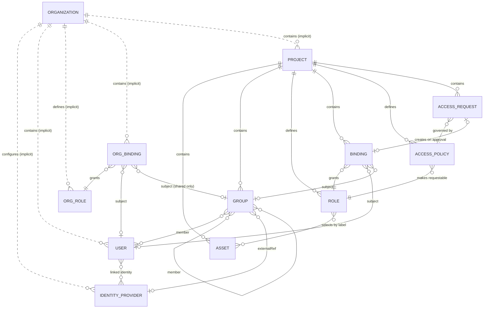
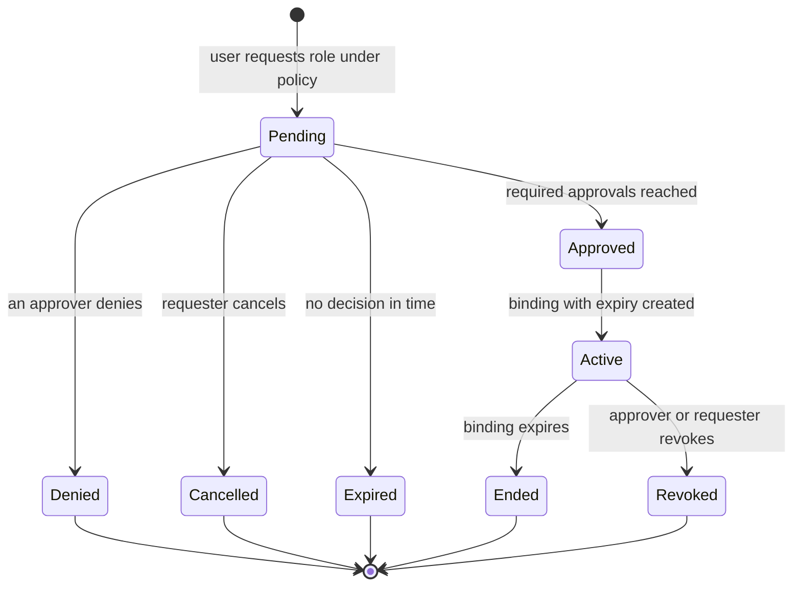
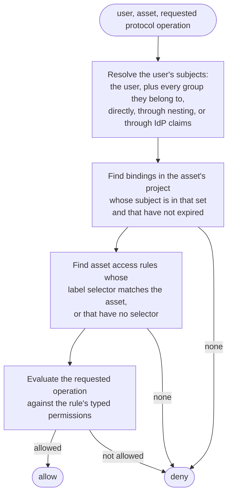

# TEP-0003: Data and authorization model

## Summary

This TEP defines the resources the Tidegate authority stores and the rules it uses to decide who may do what. It is a starting model agreed over several maintainer meetings, and later TEPs are expected to refine it.

The organization is the top level of the model. For now a Tidegate instance serves exactly one organization, which stays implicit: it is not stored and does not appear in the API. The organization holds users, identity providers, and organization roles that govern administration, such as who manages users or creates and recovers projects. All access to infrastructure lives in projects. A project holds assets, groups, roles, bindings, and access policies. An asset is one project's access definition for a target. Assets carry labels, and a project role uses label selectors and typed, protocol-specific permissions to describe access, such as logging in over SSH as `root`. A binding gives a role to a user or group, either as standing access or for a limited time after an approved access request.

The model borrows its shape from Kubernetes RBAC. An organization role works like a ClusterRole, a project works like a namespace, and a project role works like a Role.

## Motivation

Every component described in [TEP-0002](../0002-architecture/README.md) depends on the authority's data model. The API, the CLI, the web UI, the access request flow, and the authorization checks made on behalf of gateways and workers all need the same vocabulary. Agreeing on it before the API TEPs start keeps those TEPs from inventing incompatible versions of the same concepts.

Jumpgate, Tidegate's predecessor, organized assets in a folder tree and let roles cascade down folders through rewrite rules. That model is expressive, but access depends on where an asset sits in the tree and on which rules a role carries, which makes it hard to see why someone has access. The maintainers want a flatter model in which access follows from a short chain of explicit records: a binding, a role, a matching asset rule, and the typed permission that allowed the operation. Labels also suit assets that are discovered or managed by automation, because tooling can set labels without placing assets in a hierarchy.

The model also has to separate administration of Tidegate from access through Tidegate. In a PAM system, holding an organization role that manages users or identity providers should not grant shell access to production as a side effect, and owning a project should not allow changing organization settings. This separation covers roles and bindings inside Tidegate. Groups mapped to an identity provider extend trust to whoever manages group membership at that provider, as described under [Groups](#groups) and [Security considerations](#security-considerations).

### Goals

- Define the resources the authority stores, their scope (organization or project), and how they reference each other.
- Define how an access decision is evaluated, from a user's identity to a typed permission on an asset.
- Define how group membership is derived from identity provider claims, and keep that mapping explicit.
- Define the lifecycle of just-in-time access, from policy to request, approval, time-limited binding, and revocation.
- Define the rules that prevent a user from granting more access than they hold.
- Define a declarative resource format that can bootstrap a new instance.
- Avoid choices that would block hosting multiple organizations in one instance as a future feature.

### Non-goals

- Database schemas, API definitions, and wire formats. A future TEP might define them.
- The complete schema of protocol-specific asset permissions. Each worker TEP defines the typed fields and matching behavior for its protocol.
- Asset connection details, credential configuration, and target identity pinning. These belong to the asset catalog and worker TEPs.
- Identity provider protocols. This TEP assumes OIDC for examples but does not choose the supported set.
- Implementing the organization as a resource, and multi-organization support. The organization is described so the model has room for it, but the first implementation stores no organization record or organization identifier, and the API does not expose one.
- Audit event formats.

## Proposal

### Resources at a glance



| Resource | Scope | Kubernetes counterpart | Purpose |
|---|---|---|---|
| Organization | Instance | Cluster | Top-level tenant. Implicit for now: one per instance, not stored and not exposed in the API. |
| IdentityProvider | Organization | none | Configuration for an external identity provider, such as an OIDC issuer. |
| User | Organization | User | A person or service account that can sign in. |
| OrgRole | Organization | ClusterRole | Schema-validated organization and cross-project governance permissions. Never grants asset access. |
| OrgBinding | Organization | ClusterRoleBinding | Gives an OrgRole to a user or a shared group. |
| Project | Organization | Namespace | Boundary for assets and the access rules that apply to them. |
| Group | Project | none | A set of users and other groups. Optionally shared with other projects, optionally mapped to an IdP group. |
| Asset | Project | none | One project's access definition for a target, including how Tidegate identifies and connects to it. Carries labels. |
| Role | Project | Role | Schema-validated asset access rules and project-wide governance permissions. |
| Binding | Project | RoleBinding | Gives a Role to a user or group, permanently or until an expiry time. |
| AccessPolicy | Project | none | Says who may request a Role, who approves, and for how long. |
| AccessRequest | Project | none | A user's request for a Role under an AccessPolicy. |

### Organization

An organization is the tenant boundary. Users, identity providers, organization roles and bindings, and projects belong to one organization, and no reference crosses from one organization to another.

The organization is part of the model but will not be implemented for now. A Tidegate instance serves exactly one organization, and that organization is the instance itself. The authority stores no organization record and no organization identifier on other records, and neither the API nor the declarative format names an organization. Organization-level resources are therefore unique across the instance.

Hosting several organizations in one instance is a possible future feature. It would make the organization an explicit resource and require a migration that assigns existing records to a default organization and scopes names and queries by it. This TEP avoids choices that would make that harder: no reference relies on there being only one organization in a way that a default organization could not satisfy.

### Identity providers and users

An IdentityProvider resource configures an external identity source, for example an OIDC issuer with its client settings and the name of the claim that carries group membership. An organization can configure several.

A User is an organization-level identity. Users are referenced by name across all projects, so the same person has one user record no matter how many projects they work in. A user can be linked to one or more external identities, each identified by the provider and the subject the provider asserts. A user who signs in through an IdP for the first time gets a user record created and linked automatically. Signing in never links a new external identity to an existing user by matching email addresses, because an attacker who controls an email address at one provider could otherwise take over an account created through another.

Some users also need local login. When the IdP is down or misconfigured, administrators must still be able to sign in and repair the instance. Local login is opt-in per user and intended for a small number of break-glass accounts. It requires both a password and an enrolled second factor, such as TOTP or a passkey, and every local login is recorded as a distinct audit event so it can trigger alerts.

The authority stores local passwords only as self-describing password-hash strings. The initial implementation accepts [Argon2id](https://www.rfc-editor.org/rfc/rfc9106.html) in [PHC string format](https://c2sp.org/phc-strings), which identifies the algorithm, version and cost parameters alongside the salt and hash. This makes the method explicit and lets the authority reject unsupported algorithms or parameters below its security policy. The exact second-factor enrollment, storage, and recovery fields are defined by the authentication and API TEPs; local login cannot succeed until an accepted factor is enrolled.

### Organization roles and bindings

An OrgRole has a schema-validated spec that describes governance permissions. Organization-level permissions cover operations such as managing users, configuring identity providers, creating and listing projects, managing organization roles and bindings, and reading the audit log. Cross-project governance permissions may authorize specific administrative operations on project resources, such as editing groups or access policies.

The initial model has no project selector on an OrgRole. A cross-project governance permission therefore applies to every project. Organizations that need administration limited to one project use a Role and Binding in that project. More granular OrgRole fields can be added when concrete user needs justify them.

Organization roles never grant access to assets. A user who holds a superadmin OrgRole cannot open a session to any asset until a project binding gives them a project role. This keeps the administrators of Tidegate itself separate from the people who use it to reach infrastructure, and makes access to assets visible in exactly one place: project bindings.

Project recovery is an explicit OrgRole governance permission. It allows its holder to recover a project whose administrators have left by atomically ensuring that the standard project-administrator Role exists and creating a Binding from that role to themselves. It cannot bind an arbitrary Role, and it does not itself authorize an asset session. Every recovery is a distinct audit event.

An OrgBinding gives an OrgRole to a subject. The subject is a user or a shared group. Organization bindings can carry an expiry time like project bindings, described under [Bindings](#bindings).

### Projects

A project is the boundary for assets and the rules that govern access to them. Each project holds its own assets, groups, roles, bindings, access policies, and access requests. A project role can select only assets in its own project, and a project binding grants roles only within its project.

Projects let teams own their part of the asset inventory. A team that owns a project can label assets, define roles, and approve requests without organization-wide privileges and without affecting other projects.

Creating a project also bootstraps its administration. In the same transaction, the authority creates a standard project-administrator Role and binds the user who created the project to it. That role contains the project-wide permissions needed to administer the project, including defining and binding roles, but contains no asset access rules. The creator may add other administrators and may remove their own binding, even when that leaves the project without an administrator; an organization administrator with the project-recovery permission can recover it later.

### Groups

A Group is a set of members, and each member is a user or another group. Groups belong to a project. Nesting is allowed, so a `db-oncall` group can include a `platform-oncall` group. The authority rejects any change that would create a membership cycle.

By default a group is visible only within its project. A group marked as shared can also be referenced from outside its project:

- as the subject of an OrgBinding,
- as a member of a group in another project,
- as the subject of a Binding in another project,
- as a requester or approver in another project's AccessPolicy.

Sharing lets an organization define a group such as `security-team` once, in a project that owns it, and reuse it everywhere. Only the owning project can change a shared group's membership, so other projects reference it but cannot alter it.

Every cross-project group reference names both the owning project and the group. A bare group name is resolved only within the current project, so shared groups with the same name in different projects remain unambiguous.

A group can also carry an external reference to a group at an identity provider. A user who signs in through that IdP and presents the referenced group in their group claim becomes a member of the Tidegate group for as long as the claim says so. Tidegate never maps IdP groups implicitly: an IdP group named `admins` has no effect until some Tidegate group references it by provider and value. An external reference names the IdP as well as the group value, so a group claim from one provider cannot satisfy a reference meant for another.

An external reference makes the IdP's group administrators part of the Tidegate group's trust: whoever can add a user to the IdP group grants that user the Tidegate group's access, including themselves. For this reason mapping is opt-in per group, and a project can keep its sensitive groups limited to explicitly listed members.

A group can combine an external reference with explicitly listed members. Membership is then the union of both.

### Assets and labels

An Asset is a project-scoped access definition for a target that Tidegate brokers access to, such as an SSH host, a Windows host, a database, a Kubernetes cluster, or another kind supported by a worker. It describes how Tidegate identifies and connects to that target; it is not a globally unique record of the underlying machine, database, or cluster. Every asset belongs to exactly one project and has a kind, a name unique within its project, and kind-specific configuration defined by the asset catalog and worker TEPs.

Different projects can define separate assets for the same underlying system or endpoint. Each definition is administered independently and can use different credentials or credential references, protocol settings, labels, roles, and access policies. Tidegate does not link those definitions or treat changes to one as changes to the others. This lets each project own its access path without depending on an organization administrator or another project.

Assets carry labels: key-value pairs in the style of Kubernetes object labels, such as `env: prod` or `team: payments`. Labels are the only way roles select assets. Changing an asset's labels can therefore change who has access to it, so updating labels requires its own project-wide permission, described under [Project-wide permissions](#project-wide-permissions).

### Role specifications and permissions

A Role has a schema-validated spec with two independent concerns:

- Asset access rules associate a label selector with typed, protocol-specific permissions. A matching rule applies only to assets in the role's project. A rule without a selector applies to every asset in that project, including assets added later.
- Project-wide permissions govern project resources such as groups, roles, bindings, access policies, assets, and asset labels. Asset selectors do not narrow these permissions.

Role and OrgRole specs do not contain generic strings such as `project:role:edit` or `{scope, action, qualifier}` triples. Their allowed fields, values, and authorization behavior are defined by their schemas. Unknown fields and invalid combinations are rejected. Each worker TEP adds the typed asset permissions for its protocol, such as the SSH accounts or Kubernetes groups a matching rule permits.

The following example illustrates the intended shape, not final field names. It gives holders the Kubernetes `editor` group on matching assets and lets them edit access policies throughout the project:

```yaml
kind: Role
name: admin
project: myproject
spec:
  matches:
    - labelSelector: ...
      kubernetesGroup: editor
  projectWide:
    policyEditor: true
```

The detailed schemas will be developed from concrete user needs. Later TEPs may change names such as `matches`, `kubernetesGroup`, and `projectWide` before the API becomes stable, but they must preserve the separation between typed asset permissions and typed governance permissions.

#### Project-wide permissions

Project-wide permissions describe who may create and change groups, roles, bindings, access policies, and assets, and who may change asset labels. They are explicit fields in the Role spec rather than encoded strings. A role may contain both asset access rules and project-wide permissions; the authority evaluates each part independently, so a label selector never appears to restrict a project-wide permission.

### Bindings

A Binding gives a Role to a subject within a project. The subject is a user, a group in the same project, or a shared group from another project.

A binding without an expiry time is standing access. It lasts until someone deletes it. A binding with an expiry time is temporary access, and the authority removes it when it expires. Temporary bindings are usually created by an approved access request, described below, and record the request that created them. An administrator with the required project-wide permission can also create a temporary binding directly, for example to grant access during a planned maintenance window.

When a binding expires or is deleted, live sessions that depend on it end, as described under continuous revocation in [TEP-0002](../0002-architecture/README.md#continuous-revocation).

### Just-in-time access

Just-in-time access is a temporary binding created through an approved request. Three resources take part:

- An AccessPolicy makes a role requestable. It names the role, the subjects who may request it, the subjects who may approve, how many approvals a request needs, and the longest duration a request may ask for.
- An AccessRequest records one user's request for a role under a policy, with the requested duration and a justification.
- A Binding with an expiry time is the result of an approved request.



The authority enforces these rules:

- A requester can never approve their own request, even when they belong to the approver group. If the approvers named by a policy contain no one other than the requester, the request cannot be approved.
- A single denial ends the request.
- The resulting binding expires after the requested duration, capped by the policy's maximum.
- An approver of the policy or the requester can revoke the binding before it expires. Revoking ends live sessions that depend on it.
- Membership in the requester and approver sets is evaluated from standing bindings and group membership only. A temporary binding obtained through a request never makes its holder a requester or approver for another policy, so access gained through one request cannot be used to approve or obtain more.

### Who can grant access

Creating a binding or an access policy hands out the permissions of a role, so the authority checks two things. The creator must hold the project-wide permission to create bindings or policies. The creator must also be entitled to everything the role grants: either they hold every effective permission represented by the role's typed spec, on every asset its rules currently select, or their own spec explicitly permits binding that role. This mirrors the escalation check in Kubernetes RBAC, where creating a RoleBinding requires holding the role's permissions or the `bind` verb on it.

The same rule applies to roles. Creating or changing a role requires the corresponding project-wide permission, and the new or changed role cannot grant asset or governance permissions the author is not entitled to delegate. Without this rule, a user allowed to edit roles could widen a role they are already bound to. The concrete Role schema defines the explicit fields for binding or delegating permissions; they are not magic capability strings.

### Declarative configuration

Every resource has the same shape: a `kind`, a `name`, a `project` for project-level resources, and a `spec`. The authenticated CLI can apply resources in this shape during normal operation.

A new instance can accept a bootstrap file in the same format exactly once. The authority validates and applies the complete file in one transaction and records successful initialization in that transaction. If validation or application fails, the transaction is rolled back, the instance remains uninitialized, and the operator can retry. After either bootstrap or interactive initial-administrator creation succeeds, the authority rejects all later bootstrap input; later configuration changes use the authenticated API or CLI and their normal authorization checks.

As an alternative to a bootstrap file, an operator can run `authority create-initial-admin` against an uninitialized instance with no User records. The command interactively creates the initial User, enrolls a password and second factor, creates the superadmin OrgRole if needed, creates its OrgBinding, and marks the instance initialized in one transaction. It reads the password interactively, hashes it inside the authority, and never accepts it in a command-line argument or writes it to logs.

Declarative local-login credentials contain a precomputed, self-describing hash in a field such as `passwordHash`; plaintext passwords are rejected. A schematic Argon2id value has the form `$argon2id$v=19$m=<memory>,t=<iterations>,p=<parallelism>$<salt>$<hash>`. An acceptable enrolled second factor must also be present before the account can be used. The field names for that factor are left to the authentication and API TEPs.

```yaml
kind: IdentityProvider
name: github
spec:
  issuer: https://login.example.com
  groupsClaim: groups
---
kind: User
name: breakglass
spec:
  localLogin:
    passwordHash: "$argon2id$v=19$m=<memory>,t=<iterations>,p=<parallelism>$<salt>$<hash>"
    secondFactor: ... # Illustrative; the authentication TEP defines this field.
---
kind: OrgRole
name: superadmin
spec:
  # Illustrative typed governance fields; the exact schema is defined separately.
  users:
    editor: true
  identityProviders:
    editor: true
  projects:
    creator: true
    reader: true
    recoverer: true
  projectResources:
    groups:
      editor: true
    policies:
      editor: true
---
kind: Project
name: system
---
kind: Group
name: admins
project: system
spec:
  shared: true
  externalRef:
    identityProvider: github
    group: admin
---
kind: OrgBinding
name: admins-are-superadmins
spec:
  roleRef: superadmin
  subjectRef:
    kind: Group
    project: system
    name: admins
---
kind: OrgBinding
name: breakglass-is-superadmin
spec:
  roleRef: superadmin
  subjectRef:
    kind: User
    name: breakglass
```

In this example, members of the IdP group `admin` at the `github` provider become members of the shared `system/admins` group when they sign in, and through the OrgBinding they hold the `superadmin` organization role. Once provisioned with the concrete second-factor fields defined by the authentication TEP, the `breakglass` user can sign in with its local password and second factor when the IdP is unavailable. Neither has access to any asset until a project binding grants it.

### User stories

- A platform administrator bootstraps a new instance from a configuration file. Members of the company's `admin` IdP group can then sign in and administer the organization with no further setup.
- An operator who does not use a bootstrap file runs `authority create-initial-admin`, enters a password without exposing it in process arguments, enrolls a second factor, and receives the first local organization-administrator account. The command cannot run again after initialization.
- An organization administrator creates the `payments` project. The authority creates its standard project-administrator Role and binds the creator to it in the same transaction. The creator can then add the team's administrators and remove their own binding.
- The payments team owns the `payments` project. A team lead labels the production hosts `env: prod`, defines a role `prod-root` with an asset rule that matches `env: prod` and permits SSH login as `root`, and an access policy that lets the `payments-devs` group request it for up to two hours with one approval from the `payments-leads` group.
- A developer in `payments-devs` requests `prod-root` for 30 minutes to investigate an incident. A lead approves, the developer gets a binding that expires in 30 minutes, and their SSH session ends when it expires.
- The security team defines a shared group `security-oncall` in its own project. Other projects reference it as an approver group in their access policies, and the security team updates its membership in one place.
- During an IdP outage, an administrator signs in with a break-glass account to fix the identity provider configuration. The login raises an alert in the organization's SIEM.
- An auditor asks why a user could log in as `root` on a host. The answer is a chain of explicit records: the binding, the role, the selector that matched the host's labels, and the access request and approvals that created the binding.

### Risks and mitigations

- Label changes change access. Adding `env: prod` to an asset makes every asset rule that selects `env: prod` applicable to it. Changing labels requires a dedicated project-wide permission, label changes are audited, and the access check always evaluates current labels so the effect is immediate and visible.
- Separate assets can reach the same underlying system. Revoking or changing one project's asset does not affect another project's definition for the same endpoint. Operators must update each definition when a shared target changes, and audit records identify the project and asset used for each session.
- Shared groups widen the impact of a membership change. Adding a user to a shared group can grant access in projects the group owner never looks at. Only the owning project can change membership, and the audit record of a membership change lists where the group is referenced.
- IdP-derived membership can be stale. A user removed from an IdP group keeps the Tidegate membership until their claims are refreshed. Claims are refreshed on every sign-in and token refresh, and the session lifetime bounds how long stale membership can last.
- Break-glass accounts bypass the IdP and its offboarding process. Local login has its own mandatory second factor, is opt-in per user, and produces a distinct audit event. The number of such accounts is expected to be small and operators must manage their lifecycle explicitly.
- An asset access rule without a selector applies to every asset in the project, including assets added later. The API and UI show such rules as matching all project assets, and the escalation check treats their typed permissions accordingly.

## Design details

### How an access check is evaluated

When a worker asks the authority whether a user may perform an action on an asset, the authority evaluates the request in a fixed order and denies by default.



The model has no deny rules. Access is the union of what all applicable bindings grant, which keeps the result independent of evaluation order and makes every grant traceable to a single binding. Organization roles do not take part in asset access checks.

Checks for administrative actions follow the same subject and binding resolution, then evaluate the relevant typed project-wide or organization-governance field. Asset selectors do not participate in administrative checks.

Cross-project governance through an OrgRole follows the same rule but resolves OrgBindings rather than project Bindings. The project-recovery operation is narrower than general role binding: it can only restore and bind the standard project-administrator Role.

### Permission matching and validation

The authority validates Role and OrgRole specs against the schema for their resource and API version when they are written. Unknown permission fields, unknown protocol sections, invalid values, and invalid field combinations are rejected rather than ignored.

At evaluation time, the authority uses the behavior defined for the relevant typed field. For example, the SSH worker TEP defines how a role expresses permitted accounts, while the Kubernetes worker TEP defines how a role expresses groups or users to impersonate. There is no common wildcard or string-matching language across these schemas. Broad grants and protocol-specific exclusions, where needed, must be explicit parts of the relevant typed spec.

### Group membership from identity providers

When a user signs in through an identity provider, the authority reads the group claim configured on that IdentityProvider and records which externally referenced groups the user currently matches. These memberships are tracked separately from explicitly listed members. On each sign-in or token refresh, IdP-derived memberships are replaced with the current claim, and explicit memberships are left untouched.

A user who signs in with a local password has no IdP claims, so they belong only to groups that list them explicitly.

### Names and references

Organization-level resources have names unique within the organization for their kind. Project-level resources have names unique within their project for their kind. A reference to a project-level resource from another project, such as a shared group, names both the project and the resource. References are resolved by name in the declarative format and stored by immutable identifier in the database, so renaming a resource does not break references to it.

## Security considerations

- Trust boundaries. Identity providers are trusted to authenticate users and to assert group claims, but only for the groups that Tidegate explicitly maps, and only for the provider each mapping names. Using an IdP for sign-in already places it inside the trust boundary, because an IdP administrator who can sign in as a user holds that user's access in Tidegate. Multi-factor authentication with a factor only the user holds, such as a hardware key, prevents this kind of impersonation. It does not prevent an IdP administrator from adding their own account to a mapped IdP group and so granting themselves access. Group mapping is opt-in per group for this reason. Projects form an administrative boundary: a project's administrators can affect other projects only through groups they share.
- Privilege. Access to assets comes only from project bindings. Organization roles cannot reach assets, so compromising an organization administrator does not grant sessions directly. Organization governance can still lead to access indirectly: depending on the OrgRole spec, an administrator may change IdP configuration or group mappings, administer project resources, or invoke project recovery and then delegate project roles. Organization roles must therefore be guarded at least as closely as the most sensitive project. Temporary bindings expire, and the escalation check prevents users from granting permissions they are not entitled to delegate outside these explicit governance paths.
- Credentials and secrets. Local passwords are stored only as self-describing hashes, initially Argon2id PHC strings. IdP client secrets and secret material used by second factors are encrypted at rest; password hashes and secrets are never returned through the API. Bootstrap rejects plaintext passwords, unsupported hash algorithms, hashes below the configured security policy, and local-login users without an accepted second factor. Interactive initial-administrator creation reads the password without exposing it in process arguments or logs.
- Audit. Every create, update, and delete of a resource in this model is audited, along with project recovery, access requests, approvals, denials, revocations, binding expiry, IdP-derived membership changes, and local logins. The audit record of an access decision names the binding, role, matching asset rule, and typed permission that allowed it.
- Failure behavior. Unknown spec fields, unresolvable references, and roles that fail validation are rejected when they are written. At evaluation time, a binding whose role or subject cannot be resolved grants nothing. If the IdP is unavailable, IdP users cannot sign in, and break-glass accounts are the fallback.
- Threat model. In scope are a malicious requester, a compromised approver, a malicious project administrator, and a compromised IdP account. Self-approval is impossible, temporary access cannot be used to approve other requests, a project administrator cannot grant permissions beyond those they may delegate or affect projects that do not reference their shared groups, and IdP claims only affect explicitly mapped groups. A compromised identity provider can assert any mapped group and is out of scope for mitigation in this model. Organizations that need protection against it can require approvals from users who sign in with a separate factor, which a later TEP can address.

## Compatibility and upgrade

Tidegate has no released version, so this TEP has no compatibility impact. The authority API TEP defines how resource versions evolve.

## Test plan

This TEP defines no code. The authority implementation is expected to include table-driven tests for access evaluation, negative authorization tests for every escalation rule in this TEP, tests that project creation atomically establishes its initial administrator, tests that project recovery can bind only the standard administrator role, and tests that self-approval and approval through temporary bindings are rejected. Initialization tests cover transactional bootstrap, retry after rollback, rejection after successful initialization, the initial-administrator command's guards, PHC string validation and minimum parameters, rejection of plaintext passwords, and mandatory second-factor enrollment for local login.

## Rollout

The model is implemented together with the authority. A likely order:

1. Users, local login, projects, assets, roles, and standing bindings.
2. Groups, nesting, and shared groups.
3. Identity providers and external group references.
4. Access policies, access requests, and temporary bindings.
5. Declarative bootstrap and `apply` in the CLI.

## Drawbacks

- Two levels of roles and bindings mean two places to look when answering "who can do what". The split is deliberate, but tooling has to show both.
- Cross-project governance permissions are broad because the initial OrgRole model has no project selector. Sensitive permissions, especially project recovery, require careful assignment and prominent auditing.
- Labels are flat. Organizations used to a folder hierarchy, as in jumpgate, have to express their structure through label conventions.
- Projects that access the same underlying system duplicate some asset configuration and must coordinate target changes outside Tidegate.
- Shared groups create dependencies between projects that are not visible from the referencing side without tooling.
- Without deny rules, removing access for one asset from a broad role means narrowing the role's selector or splitting the role.

## Alternatives

A folder hierarchy with inherited roles, as in jumpgate, models organizational structure directly. Inheritance through rewrite rules made access hard to explain and hard to audit, which the maintainers consider a worse problem for a PAM system than the extra label conventions a flat model needs.

Storing an organization identifier on every record now, with a single organization created at bootstrap, would make multi-organization support a smaller change later. It would also add a column, a scope on every query and uniqueness constraint, and a code path that nothing exercises until the feature exists. The maintainers prefer to pay for a migration if and when multi-organization support is built.

Making an asset an organization-level resource that can belong to several projects would avoid duplicate endpoint configuration. It would also require organization-wide ownership or a separate sharing and binding model, make project administrators depend on another owner for asset changes, and complicate projects that need different credentials or levels of control over the same target. The initial model instead keeps each Asset in exactly one project. More advanced sharing can be added later if concrete use cases outweigh that administrative cost.

A single level of roles, where organization administration is expressed as fields in the Role spec of some special project, would remove the OrgRole and OrgBinding kinds. It would also let a project administrator of that special project gain organization rights, and it would mix governance and access in one evaluation path.

Implicit mapping of IdP groups to Tidegate groups by name would remove a configuration step. It would also let anyone who can create groups at the IdP grant themselves membership in any Tidegate group with the same name.

Deny rules would allow carving exceptions out of broad roles. They make the result of an access check depend on the interaction of several rules, which works against explaining access through a single binding.

## Unresolved questions

- What should the "shared" flag be called? Meetings used both "shared" and "exported", and an early bootstrap draft used `extern`. This TEP uses `shared`.
- Can org bindings be requested through access policies, so that organization administration is also just-in-time? This TEP allows org bindings with an expiry time but defines access policies only for project roles.
- Should an asset access rule be able to delegate management of the assets it selects, for example letting a team edit only assets labeled with its own team name? Project-wide permissions are deliberately not narrowed by asset selectors.
- Should access requests be able to ask for less than a whole role, for example one asset of the role's selection, as jumpgate grants were bound to a single asset?
- Should labels be limited to a defined key set per project, to keep label conventions consistent?
- How are protocol-specific exclusions expressed? Some protocols need a broad grant with exceptions, for example impersonating `cluster-admin` in a Kubernetes cluster while the proxy blocks requests to the `kube-system` namespace. Such exclusions would be represented in that protocol's typed spec and enforced by the worker inside a session. This differs from the deny rules rejected under [Alternatives](#alternatives): an exclusion narrows one permission instead of overriding grants from other bindings. The open questions are where exclusions are declared, how they combine when several bindings apply, and which workers can enforce them.

## Implementation history

- 2026-10-02: First draft, based on the model agreed in several maintainer meetings.
