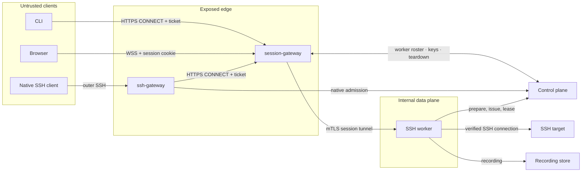
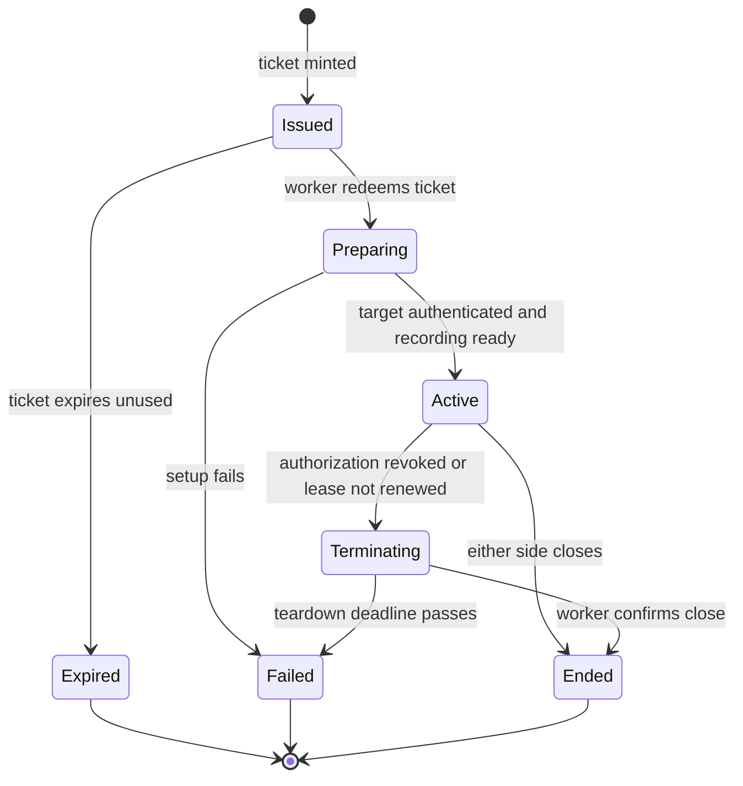
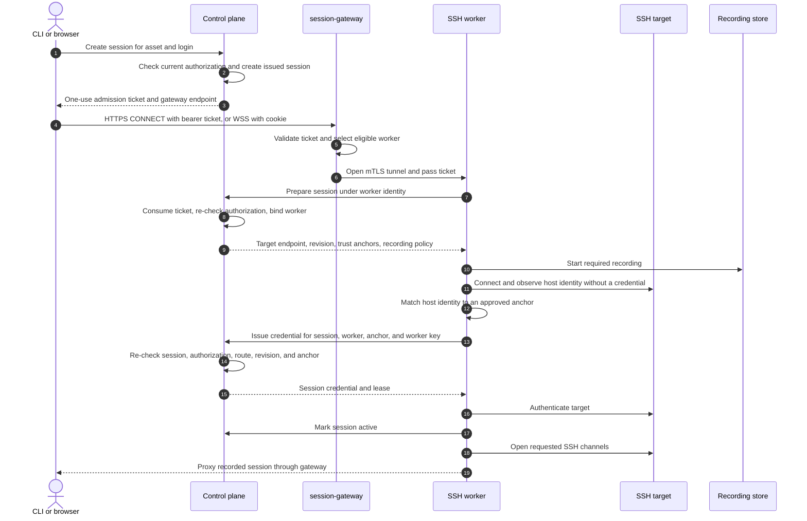
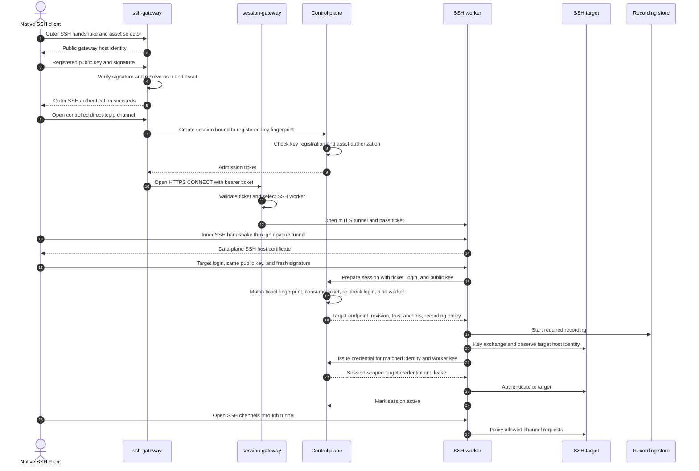

# TEP-0005: Gateway routing and session lifecycle

## Summary

This TEP defines how Tidegate turns an authorized access decision into a proxied session. The control plane creates a short-lived, single-use admission ticket. The session-gateway accepts the tunnel and chooses a compatible worker. The worker redeems the ticket, verifies the target, obtains a session credential, records the traffic, and proxies the connection. The control plane keeps the session lease and can revoke it at any time.

TEP-0002 calls the HTTPS entry point the `web-gateway`. This TEP proposes the name `session-gateway` instead. The component is not specific to web traffic: it is the common ingress, worker selector, and byte-stream router for browser sessions, CLI tunnels, and protocol gateways. The rest of this TEP uses `session-gateway`.

The same lifecycle serves every public entry point. The session-gateway validates an admission ticket, selects a compatible worker, and relays the enclosed stream without parsing its target protocol. Browser and CLI clients connect to it directly. Protocol gateways authenticate native clients and open the same ticketed tunnel on their behalf.

Native SSH uses two nested client connections. The outer SSH connection authenticates a registered user key to the ssh-gateway. A restricted `direct-tcpip` channel then carries an inner SSH connection through the session-gateway to an SSH worker. The ticket is bound to the registered key, and the worker verifies a fresh signature from the same key on the inner connection. The worker opens a separate SSH connection to the target with a session credential. The user's key never reaches the target, and the target credential never reaches either public gateway.

## Motivation

[TEP-0002](../0002-architecture/README.md) defines the control plane, gateways, and workers. It leaves several details open: what a session ticket contains, how replay is prevented, when a worker becomes responsible for a session, how target credentials are released, and how an SSH connection moves from a protocol gateway to an SSH worker. This TEP is the reference for those details when its flow differs from the illustrative flow in TEP-0002.

These details form one security boundary. A ticket that can be replayed can create a second session after a grant is revoked. A worker that receives a credential before it authenticates the target can send that credential to an impostor. A native SSH gateway that blindly asserts a user to the control plane can impersonate every user if it is compromised. A complete flow must close each of those gaps and define failure behavior across component restarts and network partitions.

### Goals

- Define one session lifecycle for browser, CLI, and native protocol clients.
- Keep authorization in the control plane and target credentials in protocol workers.
- Make admission tickets short-lived, single-use, audience-bound, and safe to route through a gateway.
- Verify target identity before releasing a target credential.
- Support prompt revocation and a bounded fail-closed path when the control plane is unavailable.
- Show the complete session-gateway and ssh-gateway flows, including the nested SSH connection used by native clients.
- Record enough state and audit data to explain who connected, to which target and login, under which authorization, and how the session ended.

### Non-goals

- Defining the role, binding, and access-request model. [TEP-0003](../0003-data-model/README.md) defines those resources.
- Choosing a token encoding, RPC framework, SSH library, or recording file format.
- Defining the exact SSH username syntax used to name a Tidegate user, asset, and target login.
- Designing protocol gateways other than SSH. They follow the lifecycle in this TEP but need their own authentication and protocol design.
- Allowing arbitrary TCP forwarding through Tidegate. Each protocol worker connects only to the endpoint of the authorized asset.
- Defining high-availability or multi-region deployment topology.

## Proposal

### Terms

The session flow uses four related objects:

| Object | Purpose | Lifetime |
|---|---|---|
| Authorization | A binding or grant that permits a user to perform an action on an asset, such as SSH login as `deploy`. | Set by policy or an approved access request. |
| Admission ticket | A signed capability to start one specific session. It names the user, asset, protocol, client binding, and expiry. It also names the requested qualifier when the ingress knows it. | Long enough to establish one connection. |
| Live session | The control-plane record for an admitted connection, owned by one worker. | From ticket redemption through teardown. |
| Session credential | The credential the worker uses for the target connection. | No longer than the live session and its authorization. |

An admission ticket is not proof that a session may continue. The worker re-checks authorization when it redeems the ticket, and the control plane renews the live session through a short lease.

### Security invariants

Every gateway and worker implementation follows these rules:

1. A client chooses only an asset and an operation allowed by its authorization. It never supplies a real network address for the target or worker.
2. A ticket starts at most one live session. The control plane records consumption durably, including after the session ends, until replay is no longer possible.
3. A gateway may reject a connection, route it, and enforce connection limits. It cannot issue a target credential.
4. A worker accepts a session only through its mutually authenticated control-plane identity. The control plane binds the session to that worker before returning target information.
5. A proof-of-possession ticket is accepted only after the worker verifies the client key named by its confirmation claim. Authentication at an edge gateway does not replace this check.
6. The worker receives the target endpoint and trust anchors from the control plane. It does not accept either from the client or gateway.
7. Target identity is verified before any target credential is released.
8. The session credential is bound to the authorized asset, login, session, and worker where the credential system supports those constraints. It expires no later than the authorization.
9. Required recording starts before the target is authenticated. A recording failure refuses or ends the session.
10. Revocation, lease expiry, user deactivation, worker loss, and authorization expiry all end the session.
11. Tickets, target credentials, private keys, and recording contents are excluded from logs.

### Components and responsibilities

The session-gateway is an authenticated session router. It terminates TLS and HTTP, validates enough of the ticket to reject malformed or expired connections, selects a worker, and relays bytes or WebSocket frames. It does not parse the protocol inside a tunnel. The CLI and ssh-gateway use the same HTTPS `CONNECT` contract. For native SSH, the tunnel payload is the opaque inner SSH byte stream, so worker selection and ticket forwarding have one implementation.

The session-gateway keeps an authenticated control stream to the control plane. It receives ticket verification keys, worker availability and capacity, and termination notices for sessions it currently carries. It maps each admitted session ID to its local client and worker connections so it can close both promptly. This is routing and connection state, not an authorization cache or the authoritative session record.

The ssh-gateway is a restricted SSH jump server at the edge. It presents Tidegate's host identity, authenticates a registered user key, reads the requested asset from the outer SSH user name, and asks the control plane for a ticket bound to that key. It accepts only a controlled `direct-tcpip` channel for the selected asset. The bytes inside that channel remain an end-to-end SSH connection between the client and worker.

The SSH worker terminates the inner SSH connection and owns the target side. It verifies that the inner client proves possession of the key named by the ticket, redeems the ticket, opens the recorder, verifies the target host identity, obtains the target credential, and proxies SSH channels to the target. The worker holds the target credential only while it owns the session.

### User stories

- A user selects an SSH asset in the web UI and opens a terminal. The browser connects to the session-gateway with a one-use ticket. The SSH worker verifies the host and opens a recorded shell as an authorized login.
- A user runs `tidegate connect deploy@web-01`. The CLI creates an ephemeral client key, binds the admission ticket to that key, and carries an SSH connection through the session-gateway. The SSH worker requires proof of the ephemeral private key before it prepares the target session.
- A user registers an SSH public key with Tidegate and connects with OpenSSH configuration supplied by Tidegate. OpenSSH authenticates an outer connection to the ssh-gateway and starts an inner connection to the worker through it. The same private key signs both handshakes.
- An approver revokes a grant while a shell is open. The control plane marks the session terminating, tells the session-gateway and worker to close it, and records the forced teardown in the audit log.
- A target presents a host key that is not approved for the asset. The worker stops before credential issuance and records a target-identity failure.

### Risks and mitigations

- A stolen bearer ticket could be used before it expires. CLI tickets are bound to an ephemeral client key. Native SSH tickets are bound to the registered key authenticated on the outer connection. Browser tickets have a short lifetime, are single-use, and are accepted only from configured origins.
- A compromised ssh-gateway can request tickets and disrupt connections, but it cannot complete inner SSH authentication without the user's private key. Inner SSH encryption also prevents it from reading or changing session contents. A compromised session-gateway has the same limits for CLI and native SSH tunnels. Browser terminal traffic remains visible to the session-gateway because the browser session terminates there.
- A compromised worker can read a session and misuse its current target credential. Session-scoped credentials, narrow target principals, short expiry, and revocation limit the exposure. Stored target passwords and private keys cannot receive all of these limits and are a compatibility exception.
- Worker selection can race with a stale roster. The selected worker must redeem the ticket under its own mesh identity. A missing or ineligible worker fails before credential issuance, and the session-gateway may choose another worker only while the ticket remains unconsumed.
- A parser flaw in a public protocol gateway is reachable before authentication. Protocol gateways run separately, enforce handshake timeouts and message limits, and have no control-plane database or target-secret access.

## Design details

### Session state machine

The control plane persists a session record before returning an admission ticket. The record is the replay guard and the source of truth for teardown.

Transitions use compare-and-set semantics in the same transaction as their audit event. Redeeming a ticket changes `issued` to `preparing` and records the worker identity. A concurrent or later redemption fails. Terminal records remain until the admission ticket has expired and the audit retention policy permits cleanup.

The session record contains at least:

- Session ID and current state.
- User, asset, protocol, requested action, and qualifier such as the SSH login.
- The binding or grant that authorized the session, when one can be identified.
- Ticket issue and expiry times.
- Owning gateway and worker identities.
- Target endpoint revision and matched trust-anchor identifier.
- Recording policy, recording object identifier, and final digest.
- Creation, activation, termination-request, and end times.
- A stable end reason.

The record does not contain a plaintext ticket or target credential. Stored ticket identifiers use a cryptographic hash when the ticket itself is opaque.

### Admission tickets

The ticket has a narrow audience and carries only routing and authorization context. Its logical claims are:

| Claim | Meaning |
|---|---|
| `session_id` | Unique identifier and replay key. |
| `subject` | Tidegate user identifier. |
| `asset` | Immutable asset identifier. |
| `protocol` | Worker protocol, such as `ssh`. |
| `action` and `qualifier` | Authorized operation, such as `login` and `deploy`. The qualifier may be deferred to worker preparation when an encrypted inner protocol supplies it. |
| `mode` | CLI tunnel, browser, or native protocol gateway. |
| `route` | Control-plane-selected worker pool or reachability class. |
| `confirmation` | Optional proof-of-possession binding. CLI SSH uses an ephemeral key fingerprint; native SSH uses the registered key fingerprint from the outer connection. |
| `issued_at`, `not_before`, `expires_at` | Ticket validity interval. |
| `issuer`, `audience`, `key_id` | Signature validation and signing-key rotation. |

The ticket contains no target address, target credential, secret, or policy document. A signed ticket may expose its claims to its holder, so no claim is treated as confidential.

Gateways validate the signature, audience, validity interval, mode, and protocol before routing. This check reduces load and rejects obvious misuse. Ticket redemption at the control plane remains authoritative because it detects replay, revocation, state changes, and a worker outside the required route.

Signing keys rotate through a key identifier. Gateways and workers receive current verification keys over the authenticated control channel and retain an old verification key only while a ticket signed by it can remain valid. An unknown key identifier fails closed.

### Worker registration and selection

A worker opens a mutually authenticated control stream and registers:

- Its workload identity and instance identifier.
- The protocols and optional feature versions it supports.
- Its internal data-plane address.
- Its reachability class or worker pool.
- Its capacity and current live session identifiers.

The control plane publishes an eligible-worker roster, including current capacity, to each session-gateway over its control stream. A session-gateway filters that roster by the signed ticket's protocol and route, excludes unhealthy or full workers, and picks the least-loaded remaining worker with randomized tie-breaking. The chosen address comes from the roster, never from the ticket or client.

The session-gateway connects to the worker over mutual TLS and verifies the exact workload identity for the roster entry. The worker also verifies that the peer is an allowed gateway type. A DNS name or network location alone is not sufficient identity.

After accepting a tunnel, the session-gateway reports that it is carrying the session ID and keeps a local mapping to both connections. The control plane sends a termination notice to that gateway when the session is revoked or its owning worker disappears. The gateway then closes the tunnel and reports its removal. These reports are operational routing state only. The control plane remains the source of truth, and the worker independently enforces the same termination through its control stream and lease.

A connection failure before ticket redemption permits another selection. Once redemption changes the session to `preparing`, another worker cannot claim it. Recovery then requires the control plane to establish that the first worker is gone and move the session to a terminal state. The client starts a new session with a new ticket.

### Session-gateway flow

The session-gateway supports HTTPS `CONNECT` tunnels from the CLI and protocol gateways, and WebSocket sessions from browsers. Both forms use the same worker preparation path.

For CLI and protocol-gateway ingress, the client opens an HTTP `CONNECT` request over TLS and presents the admission ticket as a bearer credential in the `Authorization` header. A successful response turns the exchange into a bidirectional byte tunnel as defined by [RFC 9110, Section 9.3.6](https://www.rfc-editor.org/rfc/rfc9110.html#section-9.3.6). The request authority names only the fixed Tidegate session service. It cannot name a target, worker, or arbitrary host and port. The session-gateway rejects any other authority and selects the downstream worker only from signed ticket claims and its control-plane roster. It returns success only after the worker tunnel is ready. This restriction prevents the endpoint from becoming a general-purpose forward proxy.

For a CLI SSH tunnel, the CLI creates an ephemeral SSH key pair for the connection. The ticket's confirmation claim contains the public-key fingerprint. The worker terminates the tunneled SSH connection and accepts it only after the SSH client proves possession of that key. The worker presents a short-lived SSH host certificate signed by Tidegate's data-plane SSH CA, which the CLI verifies. Theft of the ticket alone is insufficient, and the gateway cannot substitute an unauthenticated SSH server inside the tunnel.

For a browser session, the requested login is fixed in the ticket because browser JavaScript has no SSH private key. The browser sends the ticket in the body of an HTTPS request to the gateway before opening the WebSocket. The gateway stores it in a short-lived, `Secure`, `HttpOnly` cookie scoped to the session endpoint. `SameSite=Strict` is the default. A deployment with the console and gateway on different sites must opt into `SameSite=None`, keep `Secure`, and configure exact allowed origins. The WebSocket handshake carries the cookie, so the ticket never appears in a URL. The worker consumes the ticket during setup. The gateway validates both the ticket-exchange request and WebSocket `Origin` against the allowlist. Origin checking is the browser isolation control described by [RFC 6455](https://www.rfc-editor.org/rfc/rfc6455.html); it does not replace ticket validation because non-browser clients can forge the header.

HTTP access logs and tracing middleware redact authorization fields, cookies, ticket exchange bodies, and WebSocket authentication data. A reverse proxy in front of the gateway must apply the same rule.

### Native SSH authentication and admission

The ssh-gateway presents a stable SSH host key or host certificate for the public Tidegate SSH endpoint. Operators publish that identity with the gateway address. The client verifies it before sending authentication data.

The outer SSH user name identifies the asset and, if the selected syntax requires it, the Tidegate identity and target login. A registered key can identify the Tidegate user without repeating that identity in the user name. The exact grammar remains open. The gateway rejects ambiguous input and returns the same generic failure for an unknown user, asset, login, or missing authorization.

The outer connection accepts a registered public key or a short-lived Tidegate SSH user certificate. The ssh-gateway completes public-key authentication before requesting admission. An unsigned SSH public-key probe does not create a ticket or reveal whether the asset is authorized. Successful outer authentication grants no shell or forwarding access by itself.

When the authenticated client requests the controlled channel, the ssh-gateway asks the control plane for a session ticket containing the authenticated key fingerprint in its confirmation claim. The control plane verifies that the key belongs to the active user and that the user can reach the asset with at least one SSH login. When the outer selector contains a target login, the control plane checks and binds that login as well. The worker always checks the login requested by the inner SSH connection during preparation.

The client next opens a `direct-tcpip` channel through the outer connection. This is a controlled Tidegate channel, not general port forwarding. Its destination must identify the asset selected during authentication, and the first release permits one inner connection per outer connection. The ssh-gateway obtains the ticket before accepting the channel, opens an HTTPS `CONNECT` tunnel to the session-gateway, and copies the channel bytes into that tunnel.

The inner SSH handshake is the worker's proof of the client. The worker compares the offered key fingerprint with the ticket confirmation claim, then the SSH protocol verifies a fresh signature from the corresponding private key. A compromised ssh-gateway can request a ticket for a registered fingerprint, but it cannot use that ticket without the private key. The inner encryption also keeps commands and output confidential from both gateways.

Tidegate supplies SSH configuration that selects the ssh-gateway as a jump host, fixes the identity used on both connections, and pins separate outer and inner host identities. Users run a normal command such as `ssh deploy@asset`; OpenSSH creates the jump connection without a command-line `-J` option. The configuration sets `IdentitiesOnly` where needed so the outer and inner connections do not select different keys from an agent.

Registered keys authenticate Tidegate and are never installed on targets. Removing a key blocks new outer admissions and inner preparation immediately. Deactivating the user also tears down live sessions. Deployments that require phishing-resistant multi-factor authentication can require short-lived Tidegate SSH user certificates minted after an identity-provider login.

### Nested SSH tunnel

The ssh-gateway terminates only the outer SSH connection. It treats the accepted `direct-tcpip` payload as opaque bytes and applies connection limits and backpressure while copying them to the session-gateway. The session-gateway also treats the payload as opaque. Rekeying, authentication, and channel flow control for the inner connection remain between the client and SSH worker.

The ssh-gateway denies outer shell, exec, subsystem, agent-forwarding, X11, remote-forwarding, and arbitrary `direct-tcpip` requests. It does not provide a general bastion shell. A channel is accepted only for the asset named by the admission ticket and only after the ticketed session-gateway tunnel is ready.

The SSH worker supports the client-facing SSH features Tidegate can proxy and record correctly. The baseline includes shell and exec sessions, PTY allocation, and window changes. Commands carried through exec, including `rsync` and clients using the legacy SCP protocol, fit that model. SFTP requires subsystem support and a binary recording format, so a worker advertises it as a separate feature.

The following SSH features are denied by default:

- Inner `direct-tcpip` and remote TCP forwarding, because they could reach an address that is not the authorized asset. The controlled outer `direct-tcpip` channel is the transport to the worker and is the only exception.
- SSH agent forwarding, because it would expose the user's authentication agent to the target.
- X11 forwarding, because it adds another bidirectional protocol and client attack surface.
- Arbitrary environment variables. Workers use an allowlist and reject variables that can alter authentication or recording behavior.

[RFC 4254](https://www.rfc-editor.org/rfc/rfc4254.html) permits several channels in one SSH connection. Tidegate treats the client connection as one live session with separately identified channels in its recording. A future TEP may authorize forwarding as its own asset and action. It must not enable forwarding as a side effect of SSH login.

These restrictions remove forwarding features from the SSH protocol surface. They cannot stop a user with an unrestricted shell from running a tunnel program on the target. Operators enforce that boundary through target permissions and network egress policy.

### Target verification and credential release

The worker generates a fresh key pair for the target side of an SSH session. The private key remains in worker memory. It is never sent to the control plane, gateway, client, recording store, or logs.

`PrepareSession` returns the configured target endpoint, its current endpoint revision, and public trust anchors. The worker connects through SSH key exchange far enough to observe the target host key or host certificate without presenting a user credential. It validates that identity against an approved exact key or host CA, including required host-certificate principals where a CA is used.

After a local match, the worker calls `IssueSessionCredential` with:

- The session and worker identifiers.
- The endpoint revision returned by `PrepareSession`.
- The matched trust-anchor identifier and observed fingerprint.
- The fresh target-side public key.

The control plane confirms that the session is still `preparing`, belongs to the caller, remains authorized, uses the current endpoint revision, and reports an active anchor that matches the observation. It then asks the credential provider to sign the worker's public key as the authorized target login. The certificate expiry is capped by the authorization, session policy, and credential-provider limit. A shared target CA uses an asset-scoped principal enforced through the target's authorized-principals configuration. A target that cannot enforce scoped principals needs its own CA or a different credential provider, because a login-only principal could be accepted by another host that trusts the same CA.

Credential issuance is idempotent for the same session, worker, anchor, observation, and public key. A retry with different input fails and terminates the session. This rule prevents an uncertain RPC result from creating credentials for several worker keys.

SSH certificates are the preferred target credential because they can carry a short expiry, target-scoped principals, and the session ID. A password or stored private key may be injected for a target that cannot use a CA. Those credentials remain valid outside the session unless the target or credential provider rotates them, so operators must treat them as a weaker compatibility mode.

Admission-ticket signing, mesh TLS, public gateway host identity, internal worker host identity, native user certificates, and target user certificates use separate keys and certificate-authority roles. Compromise of one signer must not grant another purpose.

The worker authenticates the already verified target only after credential issuance succeeds. It marks the session `active` after target authentication succeeds and the recorder is ready. If identity verification, credential issuance, or target authentication fails, it closes the target connection, marks the session failed, and discards the fresh private key.

### Recording and audit

The worker opens the required recording before it requests a target credential. The recording API returns a unique object identifier and a bounded writer. The worker refuses the session if it cannot establish that writer. If the writer blocks beyond its deadline, rejects data, or loses the storage connection, the worker closes the session.

An SSH recording stores channel events with monotonic timestamps, direction, channel ID, event type, and payload. This supports terminal replay and also preserves exec and SFTP traffic without pretending binary traffic is a terminal cast. Recording access is a separate audited capability because recordings may contain credentials typed into a shell and sensitive target data.

The worker reports the recording's size, cryptographic digest, status, and object identifier when the session ends. The control plane appends that metadata to the session audit trail. The recording store should use retention controls or object immutability appropriate to the deployment, as described by [TEP-0004](../0004-scope-and-assumptions/README.md).

At minimum, the audit trail records:

- Ticket creation, expiry, redemption, and replay rejection.
- Native SSH authentication success and failure without storing the signature or key material.
- Gateway and worker assignment.
- Authorization source and the result of the prepare-time re-check.
- Target identity observation and matched anchor.
- Credential issuance metadata without the credential.
- Session activation, lease renewal failure, revocation, and end reason.
- Recording completion or failure.

### Leases, revocation, and teardown

The control plane gives an active session a short renewable lease. The worker renews it through its existing control stream. The control plane renews only while the user remains active, the authorization still permits the session, the ticket and target facts still match, and no teardown is pending.

Authorization changes trigger immediate re-evaluation of affected live sessions. The control plane marks the session `terminating` and sends a termination notice independently to the owning worker and the session-gateway carrying the tunnel. Repeated delivery is safe. A periodic sweep covers missed notifications, and lease expiry bounds the effect of a worker losing its control stream.

The session-gateway closes the client and worker sides of its tunnel when it receives the notice. The worker closes its client-side and target-side channels when it receives the notice or cannot renew the lease. Either action tears down the data path, while the worker-side check ensures that a compromised or disconnected gateway cannot keep an unauthorized target session alive. For a native session, closing the tunnel ends the inner SSH connection and its `direct-tcpip` channel. The ssh-gateway may keep the outer connection only long enough to report the channel failure before closing it.

The worker reports the final recording result and end reason. The control plane moves the session to `ended` only after that report. A reconciliation sweep marks a session failed if its worker disappears or does not confirm teardown by the deadline.

### Resource limits and failure behavior

Gateways enforce connection-rate, concurrent-connection, handshake-time, header-size, and initial-frame limits before allocating a worker. Protocol gateways also cap authentication attempts and pre-authentication bytes.

The control plane enforces deployment-wide per-user and per-asset concurrency in the transaction that redeems a ticket. Workers enforce local connection and channel count, frame size, recorder queue size, idle timeout, absolute session lifetime, target connect timeout, and teardown deadline. Limits are policy inputs owned by the control plane, with safe operator defaults.

The session fails closed in these cases:

- The control plane, required recording store, or credential provider is unavailable.
- No eligible worker is available.
- Ticket verification, redemption, proof of possession, or authorization fails.
- The target endpoint has changed since preparation.
- The target identity is missing, changed, expired, or unsupported.
- Credential issuance has an uncertain non-idempotent result.
- The worker loses its session lease.
- A required recorder cannot keep up with traffic.

Client errors stay generic where detail would reveal the existence of a user, asset, login, worker, or trust anchor. The audit event and internal logs carry a stable machine-readable reason for operators.

### Control-plane contracts

This TEP requires the following logical operations. A later API TEP defines their wire format.

| Operation | Caller | Result |
|---|---|---|
| `CreateSession` | Authenticated CLI or web UI | Creates an `issued` record and returns a ticket plus gateway endpoint. |
| `CreateNativeSSHSession` | Authenticated ssh-gateway | Checks the registered key, asset authorization, and outer selector, then creates an `issued` record and a key-bound ticket. |
| `GatewayStream` | Session-gateway | Reports carried session IDs and tunnel closure; streams ticket verification keys, eligible worker roster and capacity changes, and termination notices for those sessions. |
| `WorkerStream` | Worker | Registers, renews presence and session leases, reports session end, and receives teardown. |
| `PrepareSession` | Worker | Consumes a ticket, re-checks authorization, binds the worker, and returns endpoint, trust, and recording policy without a credential. |
| `IssueSessionCredential` | Owning worker | Re-verifies target identity and returns an idempotent session credential. |
| `ActivateSession` | Owning worker | Confirms target authentication and moves the prepared session to `active`. |

Every internal operation authenticates the caller through mutual TLS and authorizes its workload role. A gateway identity cannot call worker-only operations, and one worker cannot prepare or issue credentials for another worker's session.

## Security considerations

- Trust boundaries. User networks are untrusted. Gateways are exposed and terminate user-side TLS or the outer SSH jump connection. Workers and the control plane are internal. Mutual TLS identifies every gateway and worker call. Native and CLI SSH remain encrypted from the client to the worker. The worker independently verifies the key bound to the ticket, so either gateway can disrupt the tunnel but cannot read it, change it, or use the ticket without the client's private key. Gateway termination notices reduce revocation latency and release edge resources, but worker enforcement remains authoritative. Workers are trusted with plaintext session data and one credential for each live session they carry.
- Privilege. The control plane checks the asset and action at ticket creation. It checks the exact target login during preparation when the inner protocol supplies it. A live session lease never outlasts its grant. The session-gateway accepts `CONNECT` only for its fixed tunnel authority and never treats the request target as a network destination. Inner SSH port forwarding, agent forwarding, and X11 forwarding are disabled because they would add privilege beyond the authorized target login. The outer `direct-tcpip` channel can reach only the ticketed Tidegate worker path.
- Credentials and secrets. Admission tickets are short-lived and single-use. Proof-of-possession is used where the client can hold a key. Target credentials are released only to the owning worker after target verification. Fresh SSH certificates expire with the session. Tickets, private keys, passwords, and recording data are redacted from logs and traces.
- Audit. State transitions and security decisions are written with the session ID. Ticket consumption and state transition share a transaction, so a crash cannot admit a session without leaving a replay guard and audit record. Recording metadata includes a digest linked to the session audit trail.
- Failure behavior. New sessions fail closed when a required dependency is unavailable. Active sessions require renewable leases, so a lost control-plane connection ends them after a bounded interval. Required recording failure ends the session. Teardown messages are idempotent and backed by reconciliation sweeps.
- Threat model. In scope are a malicious client, a stolen admission ticket, a compromised user key, a network attacker, an impostor target, a compromised gateway, and a compromised worker. Replay guards, proof-of-possession, mutual TLS, target verification, narrow session credentials, and leases limit these threats. A compromised control plane, signing authority, recording store administrator, or worker host can defeat the controls they own and remains an operator-level risk under TEP-0004.

## Compatibility and upgrade

Tidegate has no released session protocol, so this TEP has no user-facing compatibility requirement.

Internal tickets and tunnel preambles carry explicit versions. Gateways retain each verification key needed by an unexpired ticket and remove it after the last such ticket expires. Workers advertise supported protocol versions, and gateways select only a compatible worker. A rolling upgrade must keep at least one mutually supported version between gateways, workers, and the control plane.

An in-progress session stays pinned to its gateways, worker, tunnel version, and ticket semantics. Deployments drain components before replacing them. A forced replacement closes the session and records the reason; sessions do not migrate between workers.

## Test plan

Unit tests cover ticket claim validation, signing-key rotation, state transitions, replay races, worker eligibility, SSH selector parsing, key-fingerprint binding, trust-anchor matching, credential idempotency, lease decisions, and error redaction.

Integration tests cover:

- CLI to session-gateway to SSH worker to target.
- Browser WebSocket to session-gateway to SSH worker to target.
- Native OpenSSH outer connection to ssh-gateway, inner connection through session-gateway to SSH worker, and worker connection to target.
- Rejection of a `CONNECT` request with a missing or invalid bearer ticket, an unexpected authority, or a client-selected destination.
- Rejection when the outer and inner SSH connections use different keys.
- Rejection when a compromised ssh-gateway presents an otherwise valid native ticket without a matching inner client signature.
- Verification of distinct outer-gateway and inner-worker host identities.
- Shell, exec, PTY resize, and `rsync` behavior, plus SFTP and legacy SCP when those features are advertised.
- Rejection of TCP, agent, X11, and unapproved environment forwarding.
- Ticket replay before, during, and after an active session.
- Grant revocation, expiry, user deactivation, gateway loss, worker loss, and control-stream loss.
- Independent teardown at the session-gateway and worker, including a session-gateway that misses or ignores its termination notice.
- Worker roster and capacity changes affecting new routing decisions without moving live sessions.
- Target host-key mismatch and endpoint revision changes.
- Recording unavailable at setup, recorder backpressure, and storage failure during a session.
- Component rolling upgrades with adjacent protocol versions.

Security tests fuzz every internet-facing parser and internal tunnel preamble. Negative authorization tests attempt to change the asset, login, client-key fingerprint, route, worker, anchor, endpoint revision, or worker public key at each step. Tests for the outer gateway attempt shell, exec, subsystem, agent, X11, remote-forwarding, and arbitrary `direct-tcpip` requests. Load tests hold many idle and active sessions to verify connection limits, backpressure, lease renewal, and teardown latency.

## Rollout

1. Implement the persistent session record, ticket issuance, worker stream, prepare operation, leases, and teardown without exposing a public gateway.
2. Add the session-gateway and SSH worker for CLI sessions, including target verification, SSH certificates, and recording.
3. Add browser WebSocket sessions through the same worker path.
4. Add the restricted ssh-gateway, generated OpenSSH configuration, and registered-key binding on the existing session-gateway tunnel path. Enable the outer SSH listener on a separate port for test deployments.
5. Exercise revocation, dependency failure, parser fuzzing, and rolling upgrades before making either gateway available by default.

Each stage ships only when its end-to-end negative tests pass. Stored password or private-key injection stays disabled by default until its weaker credential lifetime is documented for operators.

## Drawbacks

- Native SSH performs an outer and inner SSH handshake before the worker connects to the target. This adds round trips and public-key operations.
- OpenSSH configuration must select the jump host, the same identity for both handshakes, and the expected outer and inner host identities. Clients that cannot open a `direct-tcpip` channel through a jump host cannot use this ingress.
- A native SSH connection cannot move to another worker after the inner handshake. Worker or gateway loss ends the connection.
- The client verifies Tidegate's inner worker identity, while Tidegate verifies the target identity. The client does not verify the target's host key directly.
- Continuous authorization makes active sessions depend on the control plane and its lease path.
- Recording every supported channel adds storage, backpressure, and format complexity, especially for binary file transfers.
- Load balancers and reverse proxies in front of the session-gateway must support long-lived HTTP `CONNECT` requests, bidirectional streaming, backpressure, and tunnel closure without buffering the stream.
- Targets that accept only static passwords or private keys weaken the session-scoped credential guarantee.

## Alternatives

A single public SSH proxy could authenticate the user, obtain the target credential, connect to the target, and record the session. It would place target credentials, plaintext commands, and target-network access in the internet-facing SSH parser. A compromised proxy could impersonate users within any session it admits.

A terminating ssh-gateway could forward verified client-authentication evidence to the worker and bridge SSH channel events. This would require access to the raw SSH signature and session identifier, a custom evidence format, durable replay protection, and a semantic channel bridge. The gateway would still see and could change session contents. The nested connection uses the SSH protocol's existing proof and encryption instead.

A layer 4 gateway could send every incoming connection to an SSH worker before admission. The worker could then authenticate the client directly, but its SSH parser would be reachable by every internet client and no ticket would exist before worker selection. This conflicts with the requirement that workers receive only admitted sessions.

An end-to-end `ProxyJump` connection from the client to the target would let the target authenticate the user's key directly. Tidegate could not inject a separate session credential or record plaintext at the worker. The proposed inner connection ends at the worker, preserving both gateway isolation and target-side credential injection.

The session-gateway could authorize from the signed ticket without an online prepare step. That reduces one control-plane round trip. It cannot reliably detect ticket replay or authorization revoked after minting, and it cannot bind the live session to one worker in the control-plane ledger.

The control plane could release a credential together with the target endpoint during preparation. A worker would then hold a real credential before proving which server it reached. The two-phase prepare and issue flow keeps credentials away from an unverified target.

## Unresolved questions

- What outer SSH user-name and `direct-tcpip` destination syntax identify the Tidegate identity, asset, and optional target login without ambiguous escaping?
- What generated OpenSSH configuration works across supported clients while forcing the same outer and inner identity and pinning both host identities?
- Are registered public keys enabled by default, or does the default require a short-lived Tidegate SSH user certificate after identity-provider login?
- Which SSH environment variables are safe in the initial allowlist?
- Does the first native SSH release include SFTP and binary channel recording, or does it begin with shell and exec only?
- Which recording container stores several concurrent SSH channels and supports both terminal replay and binary streams?
- Which target credential compatibility modes are allowed when the target cannot trust Tidegate's SSH CA, and how are their weaker revocation properties shown to operators?
- Which HTTP versions are required for `CONNECT` in the first release, and may later versions multiplex several session tunnels on one connection?
- What lease duration and reconnect grace provide acceptable revocation latency without ending sessions during brief control-plane disruptions?

## Implementation history

- 2026-10-19: First draft.
