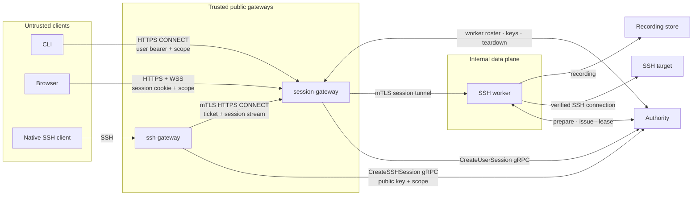
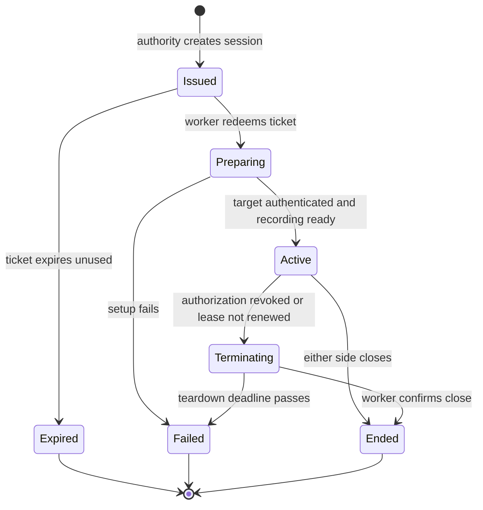
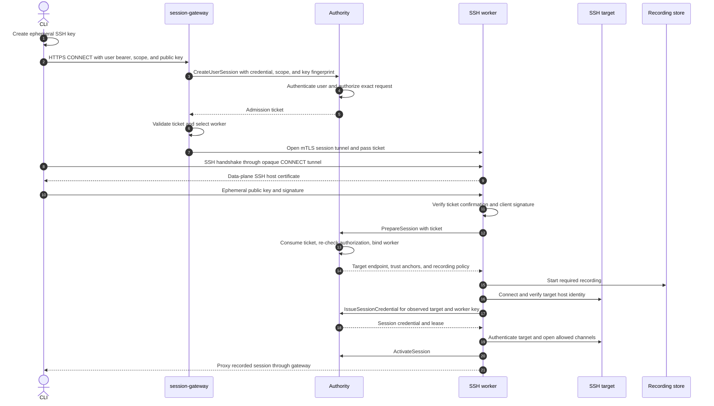
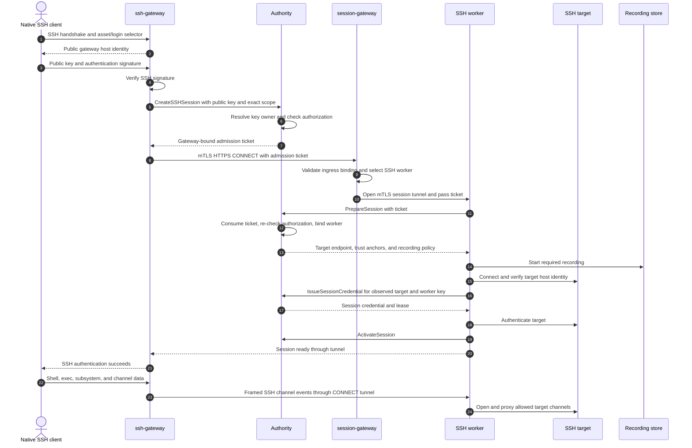

# TEP-0005: Gateway routing and session lifecycle

## Summary

This TEP defines how Tidegate turns an authenticated client request into a proxied session. An ingress gateway collects or verifies the client's authentication material and asks the authority to create a session for an exact asset, protocol, action, and qualifier such as an SSH login. The authority derives the user, checks current authorization, and returns a short-lived, single-use admission ticket. The session-gateway selects a compatible worker, and the worker redeems the ticket before it receives target details or a target credential.

TEP-0002 names the central decision-making component the `authority`; this TEP uses that name throughout. TEP-0002 calls the HTTPS entry point the `web-gateway`. This TEP proposes `session-gateway` because the component routes browser sessions, CLI tunnels, and tunnels opened by protocol gateways.

All ingress paths use the same authority and worker lifecycle:

- A CLI opens HTTPS `CONNECT` to the session-gateway with its user credential, requested scope, and an ephemeral client key.
- A browser authenticates to the session-gateway with its session cookie and opens a WebSocket after session creation.
- A native SSH client opens one SSH connection to the ssh-gateway. The ssh-gateway terminates SSH, verifies the user's public-key signature, and asks the authority to create the session for that public key and the requested scope.

The ssh-gateway is trusted to report successful client authentication. The authority derives the user from the complete public key or user certificate, so the gateway cannot choose a subject independently of that authentication material. Public keys are not secret, so possession remains an assertion made by the trusted ssh-gateway in the initial API. The gateway translates the client SSH connection into a framed session stream for the SSH worker. The session-gateway routes that stream without interpreting SSH channel semantics. The worker alone connects to the target, verifies its identity, obtains the target credential, records the session, and enforces the session lease.

## Motivation

[TEP-0002](../0002-architecture/README.md) defines the authority, gateways, and workers at a high level. It leaves several session details open: how a gateway proves who it authenticated, what a session-creation request may contain, how replay is prevented, when a worker owns a session, and when a target credential may be released.

Native SSH also needs a clear trust decision. A nested SSH design can keep session contents and user authentication opaque to the ssh-gateway, but it requires two SSH handshakes, generated jump-host configuration, and an SSH server in the worker. This proposal trusts the ssh-gateway as the client-facing SSH endpoint. Users make one ordinary SSH connection, while the worker and authority retain control over authorization, target identity, credentials, recording, and revocation.

### Goals

- Define one session lifecycle for browser, CLI, and native protocol clients.
- Define an authenticated gRPC API through which gateways request narrowly scoped sessions from the authority.
- Derive the user from authentication material instead of accepting a user identifier asserted by a gateway.
- Keep authorization and session state in the authority.
- Keep target credentials in protocol workers.
- Make admission tickets short-lived, single-use, audience-bound, and safe to pass through gateways.
- Verify target identity before releasing a target credential.
- Support prompt revocation and bounded fail-closed behavior when a required dependency is unavailable.
- Record enough state to explain who connected, which authentication method was used, what was authorized, which components carried the session, and why the session ended.

### Non-goals

- Defining the role, binding, and access-request model. [TEP-0003](../0003-data-model/README.md) defines those resources.
- Defining protobuf messages, package names, or the worker stream framing. A later API TEP specifies those wire formats.
- Choosing an SSH library or recording container.
- Defining the exact SSH username syntax used to name an asset and target login.
- Designing protocol gateways other than SSH. They use the lifecycle in this TEP but need protocol-specific authentication and translation rules.
- Allowing arbitrary TCP forwarding through Tidegate. A worker connects only to the endpoint of the authorized asset.
- Protecting a user from a compromised public gateway. Public gateways are trusted authenticators in this proposal.
- Defining high-availability or multi-region deployment topology.

## Proposal

### Terms

The session flow uses these objects:

| Object | Purpose | Lifetime |
|---|---|---|
| Authority | The trusted service that authenticates session-creation calls, decides authorization, owns session state, and issues admission tickets and target credentials. | Deployment lifetime. |
| Authorization | A binding or grant that permits a user to perform an action on an asset, such as SSH login as `deploy`. | Set by policy or an approved access request. |
| Authentication context | The credential or gateway assertion from which the authority derives the user, such as a CLI bearer token, browser session credential, or registered SSH public key. | One session-creation call. |
| Admission ticket | A signed capability to prepare one specific session. It names the authorized scope, route, ingress, and expiry. | Long enough to connect one worker. |
| Live session | The authority's record for an admitted connection, owned by one worker after ticket redemption. | From creation through teardown. |
| Session credential | The credential the worker uses for the target connection. | No longer than the live session and its authorization. |

An admission ticket allows a worker to ask the authority to prepare a session. It does not prove that the session may continue. The authority re-checks authorization when the worker redeems the ticket and renews the active session through a short lease.

### Security invariants

Every component fails closed. Missing, stale, ambiguous, inconsistent, unverifiable, or unavailable state required for a security decision causes the operation to be refused or the session to be terminated. It never causes a fallback that skips or weakens a check.

1. A client chooses a logical asset and operation. It never supplies a real network address for a target or worker.
2. A session-creation request contains the exact protocol, action, and qualifier being requested. The authority resolves the user from authentication material and ignores or rejects a caller-supplied subject.
3. The authority accepts each session-creation method only from its permitted gateway workload identities over mutual TLS.
4. An ssh-gateway request contains the complete SSH public key or user certificate. A key must resolve to exactly one active registered owner. For a user certificate, the authority validates the issuer, validity, and principal before deriving the user. A fingerprint or user ID supplied by the gateway is not authoritative.
5. A ticket can be redeemed at most once and starts at most one live session. Consumption is recorded durably before the authority returns target details. Once recorded, consumption is irreversible even if later setup fails. A retry requires a new ticket.
6. A gateway may authenticate a client, request a session, reject a connection, route it, translate its client protocol, and enforce limits. It cannot obtain or issue a target credential.
7. A worker accepts a session only through the internal data plane. The authority binds the session to the worker's authenticated workload identity before returning target details.
8. The worker receives the target endpoint and trust anchors from the authority. It accepts neither from a client nor a gateway.
9. The worker verifies target identity before the authority releases a target credential.
10. The session credential is bound to the authorized asset, login, session, and worker where the credential system supports those constraints. It expires no later than the authorization.
11. Required recording starts before target authentication. A recording failure refuses or ends the session.
12. Revocation, lease expiry, user deactivation, worker loss, and authorization expiry end the session.
13. Tickets, user credentials, target credentials, private keys, other secrets, and recording contents are excluded from logs.

### Components and responsibilities

The authority is the only component that decides whether a session may be created or continued. It owns identities, registered SSH keys, authorization, the asset catalog, live session state, ticket signing keys, trust anchors, credential providers, and the audit log.

The session-gateway is a ticket-aware session router. It terminates public HTTPS and WebSocket connections, requests sessions for authenticated CLI and browser users, performs preliminary ticket checks, selects workers, and relays session streams. It also accepts mutually authenticated tunnels from protocol gateways. Its local ticket check rejects malformed, expired, or misrouted requests early. Authoritative admission happens when the worker redeems the ticket with the authority.

The ssh-gateway is the SSH server seen by native clients. It presents Tidegate's public SSH host identity, parses the logical asset and target login, verifies client public-key authentication, and requests the corresponding session from the authority. It translates allowed SSH connection-protocol messages into the framed session stream consumed by the SSH worker. The ssh-gateway sees commands, file-transfer data, and output for native SSH sessions.

The SSH worker owns the target side. It redeems the ticket, opens the recorder, verifies the target host identity, obtains a session credential, connects to the target, and maps the admitted session stream to target SSH channels. It holds the target credential only while it owns the session.

### User stories

- A CLI user runs `tidegate connect deploy@web-01`. The CLI opens HTTPS `CONNECT` with its bearer credential and an ephemeral SSH public key. The session-gateway asks the authority for the session, then carries the CLI's SSH connection to the worker.
- A user starts a terminal in the web UI. The session-gateway uses the browser session credential to request the exact asset and login, then relays the WebSocket session to the worker.
- A user runs a normal OpenSSH command against the Tidegate SSH endpoint. The ssh-gateway verifies the key signature, the authority resolves its registered owner and authorization, and Tidegate proxies the resulting SSH channels through the session-gateway and worker.
- An approver revokes a grant while a shell is open. The authority tells the session-gateway and worker to close the session. Lease expiry covers a missed notification.
- A target presents an unapproved host key. The worker stops before credential issuance and records a target-identity failure.

### Risks and mitigations

- A compromised ssh-gateway can request a session for any registered public key it knows. Public keys are not secrets, so requiring a key in the gRPC request limits the request to a real user and current authorization but does not prove that the user participated. Mutual TLS, method-level workload authorization, exact scope checks, rate limits, and audit reduce exposure. The future proof described below can require a fresh user signature.
- A compromised session-gateway can use a CLI bearer token or browser session credential that passes through it while that credential remains valid. User credentials should have a narrow audience and short lifetime. The authority still enforces current authorization and session limits.
- A stolen native admission ticket is usable only through the session-gateway endpoint, before expiry and redemption, from the gateway workload identity named by the ticket. The gateway-to-gateway `CONNECT` endpoint requires mutual TLS.
- A compromised public gateway can read or alter sessions that terminate there. It still cannot obtain a target credential or choose a target address. The worker receives both from the authority and verifies target identity first.
- A compromised worker can read its sessions and misuse a current target credential. Session-scoped credentials, narrow target principals, short expiry, and revocation limit the exposure. Stored passwords and private keys are a weaker compatibility mode.
- A parser flaw in a public protocol gateway is reachable before user authentication. Protocol gateways run separately, limit handshake work and authentication attempts, and have no authority database or target-secret access.
- Worker selection can race with a stale roster. A worker must redeem the ticket under its own workload identity. Another worker may be selected only while the ticket remains unconsumed.

## Design details

### Session state machine

The authority persists a session record before returning an admission ticket. The record is the replay guard and the source of truth for teardown.

Transitions use compare-and-set semantics in the same transaction as their audit event. Redeeming a ticket changes `issued` to `preparing` and records the worker identity. A concurrent or later redemption fails. No failure moves a session back to `issued`; the client must start a new session. Terminal records remain until replay is no longer possible and the audit retention policy permits cleanup.

The session record contains at least:

- Session ID and state.
- User, authentication method, gateway instance, and gateway connection identifier.
- Asset, protocol, action, and qualifier such as the SSH login.
- The binding or grant that authorized the session, when one can be identified.
- Ticket issue and expiry times.
- Owning session-gateway and worker identities.
- Target endpoint revision and matched trust-anchor identifier.
- Recording policy, object identifier, status, and final digest.
- Creation, activation, termination-request, and end times.
- A stable end reason.

The record contains no plaintext ticket, user credential, target credential, or private key. Stored ticket identifiers use a modern, secure cryptographic hash when the ticket is opaque.

### Authority gRPC API

Gateways and workers call the authority through gRPC over mutual TLS. The client certificate identifies the workload and instance. Method-level authorization prevents one gateway type from using another gateway's session-creation method and prevents any gateway from calling worker-only credential methods.

`CreateUserSession` serves CLI and browser ingress through the session-gateway. The request names the asset, protocol, action, qualifier, stream kind, and optional client proof-of-possession key. The original user credential is forwarded as per-call gRPC credentials or equivalent protected metadata. The authority validates that credential and derives the user from it. The request has no authoritative `subject` field.

`CreateSSHSession` serves native SSH ingress. Its request contains:

- The complete SSH public key blob or SSH user certificate presented by the client.
- The logical asset selector, protocol, `login` action, and exact target login parsed from the SSH user name.
- A unique gateway connection identifier used as an idempotency key.
- The authenticated ssh-gateway instance from mutual TLS, supplied by the transport rather than the protobuf message.

The authority parses and canonicalizes a public key, computes its fingerprint with an approved SSH fingerprint algorithm, and requires exactly one active user registration. For a Tidegate SSH user certificate, it validates the certificate authority, validity interval, critical options, and user principal before deriving the user. It then checks current authorization for the exact asset and login. It neither accepts a user ID from the gateway nor treats a gateway-computed fingerprint as proof of identity.

An unsigned SSH public-key query does not call `CreateSSHSession`. The ssh-gateway first verifies the signed authentication request. It sends SSH authentication success only after the authority creates the session. Retries with the same gateway instance and connection identifier return the same result, so an uncertain gRPC response cannot create several sessions.

Each session-creation response contains a one-use admission ticket and the session-gateway endpoint. Tickets created for protocol gateways name the exact ingress workload identity. The session-gateway accepts them only on its mutual TLS endpoint from that identity.

### Admission tickets

An admission ticket carries routing and authorization context:

| Claim | Meaning |
|---|---|
| `session_id` | Unique identifier and replay key. |
| `subject` | User identifier derived by the authority. |
| `asset` | Immutable asset identifier. |
| `protocol` | Worker protocol, such as `ssh`. |
| `action` and `qualifier` | Authorized operation, such as `login` and `deploy`. |
| `stream_kind` | Worker-facing stream, such as `ssh-wire` or `ssh-events`. |
| `route` | Authority-selected worker pool or reachability class. |
| `ingress` | Gateway type and instance that authenticated the client. |
| `confirmation` | Optional client proof-of-possession binding. CLI SSH uses its ephemeral public-key fingerprint. |
| `issued_at`, `not_before`, `expires_at` | Ticket validity interval. |
| `issuer`, `audience`, `key_id` | Signature validation and signing-key rotation. |

The ticket contains no target address, target credential, user credential, secret, or policy document. Signed claims are visible to the ticket holder and are not confidential.

The session-gateway validates the signature, audience, validity interval, ingress binding, protocol, stream kind, and route before selecting a worker. This preliminary check limits load and rejects obvious misuse. Worker redemption at the authority remains authoritative because it detects replay, revocation, authorization changes, and an ineligible worker.

Signing keys rotate through `key_id`. Gateways and workers receive current verification keys over authenticated control streams and retain an old verification key only while its tickets can remain valid. An unknown key identifier fails closed.

### Worker registration and selection

A worker opens a mutually authenticated gRPC stream to the authority and registers:

- Its workload identity and instance identifier.
- Its supported protocols, stream kinds, and feature versions.
- Its internal data-plane address and reachability class.
- Its capacity and current live session identifiers.

The authority publishes the eligible-worker roster and current capacity to each session-gateway. The gateway filters by the signed protocol, stream kind, and route, excludes unhealthy or full workers, and picks the least-loaded remaining worker with randomized tie-breaking. The worker address comes from the roster, never from a ticket, client, or protocol gateway.

The session-gateway connects to the selected worker over mutual TLS and verifies the workload identity for the roster entry. The worker verifies the session-gateway identity. A DNS name or network location alone is insufficient.

After accepting a tunnel, the session-gateway reports the session ID and keeps a local mapping to its client-side and worker-side connections. The authority sends termination notices for sessions carried by that gateway. These reports are routing state; the authority's session record remains authoritative, and the worker independently enforces termination and lease expiry.

A connection failure before redemption permits another worker selection. Once redemption changes the session to `preparing`, another worker cannot claim it. Recovery moves the original session to a terminal state, and the client starts a new session.

### CLI and browser flow

The session-gateway creates sessions for both public HTTPS transports. The authority sees the original user credential on each creation call and derives the user itself.

The CLI uses HTTP `CONNECT` over TLS to the configured session-gateway host and port and sends the user bearer credential in the `Authorization` header. The requested asset, action, login, and ephemeral public key use bounded request fields. A successful response creates the bidirectional tunnel defined by [RFC 9110, Section 9.3.6](https://www.rfc-editor.org/rfc/rfc9110.html#section-9.3.6). The request target never names a target or worker. The gateway returns success only after the worker tunnel is ready.

The admission ticket stays inside Tidegate. The worker verifies possession of the CLI's ephemeral key before redemption, so a copied ticket does not authenticate a different SSH client. The session-gateway sees CONNECT metadata but cannot read the SSH payload between the CLI and worker.

A browser first sends an authenticated HTTPS session-setup request to the session-gateway. The requested asset and login are in the request body, not the URL. The gateway validates the request origin and CSRF protection before calling `CreateUserSession` with the browser session credential and exact requested scope. It returns the admission ticket in a separate short-lived, `Secure`, `HttpOnly` cookie scoped to the WebSocket endpoint. `SameSite=Strict` is the default. Cross-site deployments use `SameSite=None`, keep `Secure`, and configure an exact origin allowlist.

The WebSocket handshake carries the cookie. The session-gateway validates the cookie and `Origin`, selects a worker, and relays the framed browser session. Origin checking follows [RFC 6455](https://www.rfc-editor.org/rfc/rfc6455.html) and does not replace ticket validation because a non-browser client can forge the header. Browser session traffic is visible to the session-gateway.

HTTP and gRPC logging middleware redact authorization metadata, cookies, request fields that contain keys or credentials, ticket responses, and WebSocket authentication data. A reverse proxy in front of the session-gateway applies the same rules.

### Native SSH flow

The native client makes one SSH connection. The ssh-gateway terminates SSH and presents a stable host key or host certificate for the public Tidegate endpoint. Operators publish that identity with the endpoint.

The SSH user name identifies the logical asset and target login. A registered public key identifies the Tidegate user, so the user name does not need a separate user identifier. The gateway rejects ambiguous selectors and returns the same generic failure for an unknown key, asset, login, or missing authorization.

The ssh-gateway calls `CreateSSHSession` only after it verifies the signed public-key authentication request. An unsigned key probe performs no authority call and reveals no authorization result. The authority creates a session only when the key resolves to one active user and that user may access the exact asset and login. The ssh-gateway waits for the worker's ready signal before reporting SSH authentication success, so it does not need to buffer post-authentication channels during target setup.

After admission, the ssh-gateway opens HTTPS `CONNECT` to the session-gateway's internal mutual TLS endpoint. The ticket is a bearer credential in the `Authorization` header and is bound to the ssh-gateway instance. The tunnel carries a versioned stream of SSH channel events. The session-gateway relays the stream without parsing its channel semantics. TLS terminates there, so the session-gateway can read the unparsed stream.

The ssh-gateway and worker both enforce the ticket's scope. The initial feature set includes shell and exec sessions, PTY allocation, window changes, and bounded environment variables. SFTP is a separately advertised feature because it needs subsystem support and a recording format for binary operations. Commands using exec, including `rsync` and legacy SCP, use the exec path.

The following requests are denied:

- Local and remote TCP forwarding, because they can reach an address outside the authorized asset.
- SSH agent forwarding, because it exposes the user's authentication agent.
- X11 forwarding, because it adds another bidirectional protocol and client attack surface.
- Environment variables outside an allowlist.

The ssh-gateway rejects these requests at the client boundary, and the worker rejects corresponding session events. An unrestricted shell can still run a tunnel program on the target. Target permissions and network egress policy enforce that separate boundary.

Registered user keys are never installed on targets. Removing a key blocks new `CreateSSHSession` calls. Deactivating the user also ends live sessions. Deployments that require multi-factor authentication can require short-lived Tidegate SSH user certificates issued after an identity-provider login.

### Future SSH client proof

The initial gRPC API trusts the ssh-gateway's statement that it verified the client signature. A later revision can send verifiable SSH authentication evidence to the authority without adding a second SSH connection.

[RFC 4252, Section 7](https://www.rfc-editor.org/rfc/rfc4252.html#section-7) defines the public-key authentication signature over the SSH session identifier, user name, service name, method, algorithm, and public key. An ssh-gateway that can access those exact fields and the raw signature could include them in `CreateSSHSession`. The authority could reconstruct the signed bytes, verify the signature with the registered key, and require the asset and login to match the signed SSH user name.

This proof needs replay and freshness rules. The standard signature contains no authority-issued nonce or expiry. The authority would need a durable one-use digest for each accepted proof, or a protocol extension that places a short-lived authority challenge in data signed by the client. The latter is difficult to add transparently to unmodified OpenSSH clients. SSH libraries also differ in whether they expose the original signature and session identifier. These constraints keep transcript verification out of the initial API.

Transcript verification would stop a compromised gateway from creating a session without a corresponding client signature. It would not hide session contents from the ssh-gateway. End-to-end confidentiality requires the nested SSH design described under Alternatives.

### Target verification and credential release

The worker generates a fresh key pair for the target side of an SSH session. The private key remains in worker memory and is never sent to the authority, a gateway, the client, the recording store, or logs.

`PrepareSession` returns the configured target endpoint, endpoint revision, and public trust anchors. The worker performs SSH key exchange far enough to observe the target host key or host certificate without presenting a user credential. It matches that identity against an approved exact key or host CA, including required host-certificate principals.

After a local match, the worker calls `IssueSessionCredential` with:

- The session and worker identifiers.
- The endpoint revision returned by `PrepareSession`.
- The matched trust-anchor identifier and observed fingerprint.
- The fresh target-side public key.

The authority confirms that the session is still `preparing`, belongs to the caller, remains authorized, uses the current endpoint revision, and reports an active anchor that matches the observation. It then asks the credential provider to sign the worker's public key as the authorized target login. Certificate expiry is capped by the authorization, session policy, and credential-provider limit. A shared target CA uses an asset-scoped principal enforced by the target's authorized-principals configuration. A target that cannot enforce scoped principals needs its own CA or another credential provider.

Credential issuance is idempotent for the same session, worker, anchor, observation, and public key. A retry with different input fails and terminates the session. This prevents an uncertain RPC result from creating credentials for several worker keys.

SSH certificates are preferred because they can carry a short expiry, target-scoped principals, and the session ID. A password or stored private key may be injected for a target that cannot trust a Tidegate CA. Those credentials can remain valid outside the session unless the target or provider rotates them, so operators treat them as a weaker compatibility mode.

Admission-ticket signing, mesh TLS, public gateway host identity, native user certificates, and target user certificates use separate keys and certificate-authority roles. Compromise of one signer does not grant another purpose.

The worker authenticates the verified target only after credential issuance succeeds. It marks the session `active` after target authentication and recorder setup. A failure closes the target connection, marks the session failed, and discards the fresh private key.

### Recording and audit

The worker opens the required recording before requesting a target credential. The recording API returns a unique object identifier and bounded writer. If the writer cannot be established, blocks beyond its deadline, rejects data, or loses storage, the worker refuses or closes the session.

An SSH recording stores channel events with monotonic timestamps, direction, channel ID, event type, and payload. This supports terminal replay and preserves exec and file-transfer traffic without treating binary data as a terminal cast. Recording access is a separate audited capability because recordings can contain credentials typed into a shell and sensitive target data.

The worker reports recording size, a cryptographic digest, status, and object identifier when the session ends. The authority appends that metadata to the session audit trail. The recording store uses retention controls or object immutability appropriate to the deployment, as described by [TEP-0004](../0004-scope-and-assumptions/README.md).

The audit trail records at least:

- Session creation, ticket expiry, redemption, and replay rejection.
- Gateway workload identity and authentication method.
- For SSH, the registered key identifier and authentication result without storing signatures or key material unnecessarily.
- Requested and authorized asset, action, and login.
- Gateway and worker assignment.
- Authorization source and prepare-time re-check.
- Target identity observation and matched anchor.
- Credential issuance metadata without the credential.
- Activation, lease failure, revocation, and end reason.
- Recording completion or failure.

### Leases, revocation, and teardown

The authority gives an active session a short renewable lease. The worker renews it over `WorkerStream`. Renewal succeeds only while the user remains active, authorization still permits the session, session and target facts still match, and no teardown is pending.

Authorization changes cause immediate re-evaluation of affected sessions. The authority marks the session `terminating` and sends termination independently to the worker and the session-gateway carrying the tunnel. Repeated delivery is safe. A periodic sweep covers missed notices, and lease expiry bounds the effect of a worker losing its control stream.

The session-gateway closes both sides of its tunnel. The worker closes its ingress stream and target channels. Either action breaks the data path, while worker enforcement ensures that a compromised or disconnected gateway cannot keep target access alive. For native SSH, the closed CONNECT tunnel tells the ssh-gateway to close the client SSH connection.

The worker reports the final recording result and end reason. The authority moves the session to `ended` only after that report. A reconciliation sweep marks a session failed if its worker disappears or does not confirm teardown by the deadline.

### Resource limits and failure behavior

Gateways enforce connection rate, concurrent connections, handshake time, header size, initial frame size, and bounded pre-session buffering. Protocol gateways also cap authentication attempts and unauthenticated bytes.

The authority enforces deployment-wide user and asset concurrency in the ticket-redemption transaction. Workers enforce local connection and channel counts, frame size, recorder queue size, idle timeout, absolute lifetime, target-connect timeout, and teardown deadline. Policy supplies these limits with safe operator defaults.

The session fails closed when:

- The authority, required recording store, or credential provider is unavailable.
- Client authentication or exact-scope authorization fails.
- No eligible worker is available.
- Ticket verification, ingress binding, or redemption fails.
- CLI proof of possession fails.
- The target endpoint changes after preparation.
- Target identity is missing, changed, expired, or unsupported.
- Credential issuance has an uncertain non-idempotent result.
- The worker loses its session lease.
- A required recorder cannot keep up.

Client errors remain generic where detail would reveal a user, key registration, asset, login, worker, or trust anchor. Audit events and internal logs carry stable machine-readable reasons.

### Authority contracts

The initial authority API uses gRPC over mutual TLS. A later API TEP defines protobuf packages and messages.

| Operation | Caller | Result |
|---|---|---|
| `CreateUserSession` | session-gateway | Authenticates the forwarded CLI or browser credential, checks exact scope, creates an `issued` session, and returns a ticket. |
| `CreateSSHSession` | ssh-gateway | Resolves the presented SSH key or certificate, checks exact scope, creates an `issued` session, and returns an ingress-bound ticket. |
| `GatewayStream` | session-gateway | Reports carried sessions and tunnel closure; receives ticket keys, worker roster and capacity changes, and termination notices. |
| `WorkerStream` | Worker | Registers, renews presence and session leases, reports session end, and receives termination notices. |
| `PrepareSession` | Worker | Consumes a ticket, re-checks authorization, binds the worker, and returns endpoint, trust, and recording policy without a credential. |
| `IssueSessionCredential` | Owning worker | Re-verifies target identity facts and returns an idempotent session credential. |
| `ActivateSession` | Owning worker | Confirms target authentication and moves the prepared session to `active`. |

The authority applies deadlines, request-size limits, idempotency, workload authorization, and audit logging to every method. User credentials, SSH key blobs, signatures, tickets, and credentials are redacted from gRPC logs and traces.

## Security considerations

- Trust boundaries. User networks are untrusted. The ssh-gateway is trusted to authenticate native SSH users. The session-gateway forwards the original CLI bearer or browser session credential for validation by the authority. Both gateways terminate client-facing transports and may see plaintext for the protocols they terminate. CLI SSH remains encrypted between the CLI and worker. Workers and the authority are internal. Mutual TLS identifies every gateway and worker call.
- Gateway compromise. A compromised gateway can act within the client identities and credentials available to it. The authority still checks exact current authorization, and gateways cannot obtain target credentials or provide target addresses. The simple SSH assertion cannot prove possession to the authority; transcript proof is a future hardening measure.
- Privilege. The authority checks the exact asset, action, and login at creation and redemption. The session-gateway never treats a CONNECT request target as a network destination. SSH forwarding, agent forwarding, X11, and unapproved environment variables are disabled.
- Credentials and secrets. Admission tickets are short-lived, single-use, and bound to the expected ingress where applicable. CLI tickets also use proof of possession. Target credentials go only to the owning worker after target verification.
- Audit. State transitions and security decisions use the session ID. Ticket consumption and state transition share a transaction, so a crash cannot admit a session without a replay guard and audit record.
- Failure behavior. New sessions fail closed when a required dependency is unavailable. Active sessions require renewable leases. Required recording failure ends the session. Termination messages are idempotent and backed by reconciliation.
- Threat model. In scope are a malicious client, stolen user credential or ticket, compromised user key, network attacker, impostor target, compromised gateway, and compromised worker. A compromised authority, certificate authority, recording-store administrator, or worker host can defeat the controls it owns and remains an operator-level risk under TEP-0004.

## Compatibility and upgrade

Tidegate has no released session protocol, so this TEP has no user-facing compatibility requirement. Native SSH uses a single ordinary SSH connection and requires no `ProxyJump` configuration or second Tidegate host identity.

Admission tickets and session-stream preambles carry explicit versions. Gateways retain each verification key needed by an unexpired ticket. Workers advertise supported protocol, stream, and feature versions. A rolling upgrade keeps at least one mutually supported version between each connected component.

An active session stays pinned to its gateways, worker, stream version, and ticket semantics. Deployments drain components before replacing them. A forced replacement closes the session and records the reason; sessions do not migrate between workers.

## Test plan

Unit tests cover authentication-context validation, gateway method authorization, SSH key canonicalization, key-owner lookup, exact-scope authorization, ticket claims, ingress binding, state transitions, replay races, idempotency, worker eligibility, target trust, credential issuance, leases, and redaction.

Integration tests cover:

- CLI bearer authentication through HTTPS `CONNECT`, ephemeral-key proof at the worker, and target SSH.
- Browser session authentication, ticket cookie exchange, WebSocket origin checks, and target SSH.
- Native OpenSSH public-key authentication at the ssh-gateway, gRPC session creation, framed channel proxying, and target SSH.
- Rejection when a gateway supplies a user ID, fingerprint without a full key, unregistered key, mismatched scope, unauthorized login, or unsupported stream kind.
- Rejection when the gRPC caller workload is not authorized for the requested method.
- Rejection of a protocol-gateway ticket on the public CONNECT endpoint, from the wrong mutual TLS identity, or with an unexpected request authority.
- Shell, exec, PTY resize, and `rsync`, plus SFTP and legacy SCP when advertised.
- Rejection of TCP, agent, X11, and unapproved environment forwarding at both ssh-gateway and worker.
- Ticket replay before, during, and after an active session.
- Ticket replay after preparation, recording, target connection, authentication, or activation fails.
- Grant revocation, expiry, user deactivation, key removal, gateway loss, worker loss, and control-stream loss.
- Independent termination at session-gateway and worker, including a gateway that misses or ignores its notice.
- Worker roster changes affecting new routing decisions without moving live sessions.
- Target host-key mismatch and endpoint revision changes.
- Recording unavailability, backpressure, and failure during a session.
- Rolling upgrades with adjacent protocol versions.

Security tests fuzz every internet-facing parser, gRPC request parser, and session-stream preamble. Negative tests change the asset, login, public key, route, ingress identity, worker, anchor, endpoint revision, or worker public key at each step. Load tests hold idle and active sessions to verify admission limits, backpressure, lease renewal, and teardown latency.

## Rollout

1. Implement the authority's gRPC session record, ticket issuance, worker stream, preparation, leases, and teardown.
2. Add `CreateUserSession`, the session-gateway, and an SSH worker for CLI `CONNECT` sessions.
3. Add browser WebSocket sessions through the same session-gateway and worker lifecycle.
4. Add `CreateSSHSession`, the trusted ssh-gateway, and the framed SSH event stream. Start with shell, exec, PTY, and window changes.
5. Add optional SFTP and other recorded features after their framing and recording formats pass security review.
6. Exercise revocation, dependency failure, parser fuzzing, workload-identity enforcement, and rolling upgrades before enabling public gateways by default.

Stored password or private-key injection stays disabled by default until operators can see and accept its weaker lifetime and revocation properties.

## Drawbacks

- The ssh-gateway is trusted with native client identity and plaintext. Its compromise can impersonate registered keys known to it within their current authorization.
- Translating SSH channels into a worker stream adds a protocol boundary that must preserve flow control, request results, exit status, and backpressure.
- Native sessions depend on both gateways and one worker. Loss of any component ends the connection.
- Native clients verify the Tidegate ssh-gateway host identity. Tidegate, rather than the client, verifies the target host identity.
- Continuous authorization makes active sessions depend on the authority and its lease path.
- Recording every supported channel adds storage and backpressure, especially for binary file transfers.
- Load balancers and reverse proxies must support long-lived HTTP `CONNECT`, bidirectional streaming, backpressure, and tunnel closure without buffering.
- Targets that accept only static passwords or private keys weaken the session-scoped credential guarantee.

## Alternatives

The native client could create a second SSH connection through the ssh-gateway to the worker. The worker would verify the user's key directly, and both gateways would be blind to the inner SSH payload. This reduces trust in the gateways but requires two SSH handshakes, a second host identity, generated jump-host configuration, and compatible `direct-tcpip` behavior. It remains a possible hardened mode if the simpler trusted-gateway model proves insufficient.

The ssh-gateway could connect directly to targets. That would place target credentials, target-network access, recording, and target host verification in an internet-facing SSH parser. Keeping those responsibilities in the worker limits the ssh-gateway's privilege.

A layer 4 gateway could expose workers to incoming SSH before admission. Workers would then authenticate clients directly, but their SSH parsers would be reachable from the internet and no session would exist before worker selection.

The authority could accept a user ID asserted by the ssh-gateway. The public key would then have no effect on the authorization decision, and a gateway bug could select any user. The proposed API requires the full key and derives its registered owner.

The session-gateway could authorize from a signed ticket without worker redemption. That would remove one authority round trip but would not reliably detect replay, authorization revoked after creation, or an ineligible worker.

The authority could release a target credential during preparation. The worker would then hold a credential before proving which server it reached. The two-phase prepare and issue flow prevents that.

## Unresolved questions

- What SSH user-name grammar identifies the logical asset and target login without ambiguous escaping?
- Which SSH channel events and error mappings make up version 1 of the gateway-worker stream?
- Does the first native SSH release include SFTP and a binary recording format, or only shell and exec?
- Are registered public keys enabled by default, or must users present short-lived Tidegate SSH certificates after identity-provider login?
- Which user credential type and audience does the session-gateway forward to `CreateUserSession`?
- Which HTTP versions are required for `CONNECT`, and may later versions multiplex session tunnels?
- What lease duration and reconnect grace provide acceptable revocation latency during brief authority disruptions?
- Which target credential compatibility modes are allowed when a target cannot trust Tidegate's SSH CA?
- Should a later release implement SSH transcript proof, and can the selected SSH library expose the exact signed fields without custom client behavior?

## Implementation history

- 2026-10-19: First draft.
- 2026-10-23: Replaced nested SSH with a trusted ssh-gateway, adopted the authority naming, introduced its gRPC API, and unified gateway session creation.
