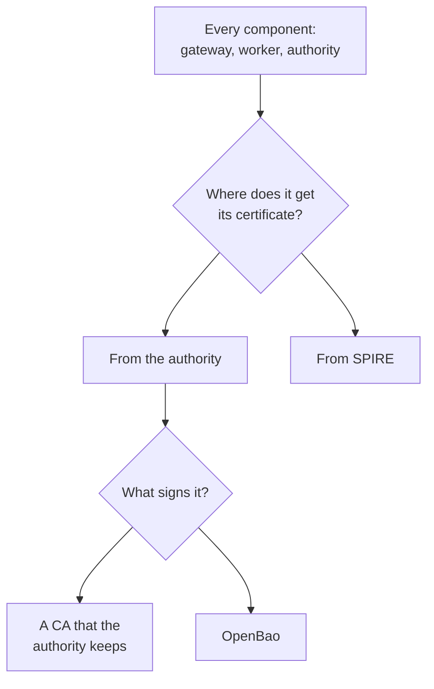
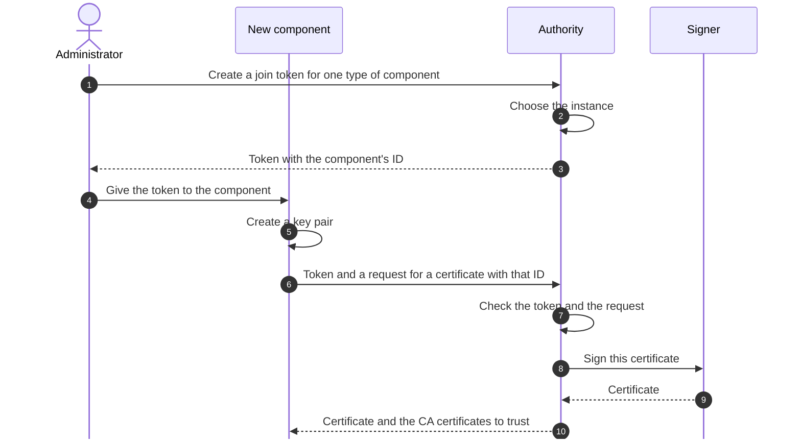
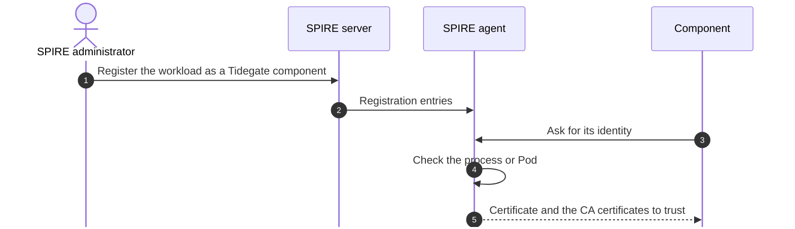

# TEP-0007: Workload identity for the internal mesh

## Summary

Tidegate's components talk to each other over mutual TLS, and each one has to prove which component it is. [TEP-0002](../0002-architecture/README.md) says so, and [TEP-0005](../0005-gateway-sessions/README.md) builds on it, but neither says where a component's certificate comes from. This TEP defines that.

A certificate carries one SPIFFE ID that names the installation and the component's type and instance. Every component checks that ID on every connection in the mesh. The operator chooses where the components get their certificates: from the authority, where each component joins once with a single-use token, or from SPIRE if they already run it. When the authority hands out the certificates, the operator also chooses what signs them: a CA that the authority keeps itself, or OpenBao. Nobody has to run a CA for Tidegate or sign a certificate by hand.

## Motivation

Nothing issues certificates to Tidegate's components yet, so the authority's internal API can't check who calls it. TEP-0002 says that each component has "a workload identity issued by one of the authority's certificate authorities". TEP-0005 relies on that identity when it lets only a worker redeem a ticket and only the right gateway create a session. No TEP says how the CA is created, how a new gateway or worker gets its first certificate, or what the certificate contains.

The simplest answer is that every component reads its certificate from files the operator provides. The operator then has to run a CA and sign a certificate for every component by hand. Few operators will do that for one tool.

Tidegate has to work in two kinds of installation. Some operators run it in Kubernetes and already have software that issues certificates. Others run it on servers that they set up by hand, without such software.

### Goals

- Every component has an identity that names its type and instance, and every connection in the mesh checks it.
- An installation on servers that are set up by hand needs no other software for this.
- An operator who runs OpenBao or SPIRE can use it for the components' certificates.
- A certificate looks the same and is checked the same way, wherever it comes from.

### Non-goals

- The certificates that users see, like the authority's certificate for its external API.
- The authority's other keys. TEP-0005 keeps the key for admission tickets and the SSH CAs apart from mesh TLS.
- Which type of component may call which method. TEP-0005 and the later API TEP decide that.
- Agents. TEP-0002 places them in target networks, which must not reach the authority's internal API. A later TEP defines how an agent gets its identity.
- A second automatic way to get a certificate. An installation whose components get their certificates without a person uses SPIRE.
- Identities from more than one SPIFFE trust domain.

## Proposal

### What a certificate says

A component's certificate carries one URI in its subject alternative names, a [SPIFFE ID](https://github.com/spiffe/spiffe/blob/main/standards/SPIFFE-ID.md). It names the installation and the component's type and instance:

```
spiffe://tidegate.example.com/ssh-worker/5d2c9b0e
```

The part before the type is the same for all components of an installation. This TEP calls it the installation's ID prefix.

Tidegate uses the SPIFFE format for the name. It doesn't need other SPIFFE software for that.

A peer first verifies the certificate against the CA certificates it trusts. Then it checks this ID. A component that connects to a worker checks that the certificate names the worker instance it expects. TEP-0005 requires such a check: "A DNS name or network location alone is insufficient." Tidegate checks no host name at all, and a certificate needs no DNS names.

A component has one certificate. It uses it as a client and as a server, because a worker accepts connections from a gateway and opens connections to the authority.

### Where certificates come from

The operator makes two choices. The second choice only exists when the certificates come from the authority. This TEP calls the software that signs those certificates the signer.



All components of an installation get their certificates the same way. Three things are the same in every installation and can't be configured: what a certificate looks like, what a peer checks on a connection, and which type of component may call which method.

### Certificates from the authority

The authority decides who gets a certificate and what it says. The signer only signs. Gateways and workers never talk to the signer.



The private key never leaves the component.

With tokens, joining is one step for each component. A person does it, or the operator's own automation. An installation whose components should get their certificates without such a step uses SPIRE.

### Certificates from SPIRE

With SPIRE, the authority hands out nothing. Each component, the authority included, gets its certificate from the SPIRE agent on its host.



With SPIRE, more people can create a Tidegate component. Everyone who can register a workload in SPIRE's trust domain can create an identity that Tidegate accepts as a worker or as the authority. So can everyone who can start a workload that matches one of Tidegate's registrations. A worker receives credentials for targets. With certificates from the authority, only a Tidegate administrator can create a component.

### User stories

- An operator installs the authority, a gateway and a worker on three servers by hand. They create a token for the gateway and one for the worker with the CLI, and each component fetches its certificate when it starts.
- An operator who runs OpenBao sets up a PKI there for Tidegate and gives the authority the public certificate of its CA. The CA key stays in OpenBao, and components still join with tokens.
- An operator who runs SPIRE registers the Tidegate components as workloads. No tokens exist in that installation.

### Risks and mitigations

- A signer that is set up too openly lets someone other than the authority get a certificate with one of this installation's IDs. This TEP states the conditions for each signer, the authority checks every certificate that a signer returns, and it refuses an ID that it didn't hand out.
- A join token leaks before it's used. It works once and expires after an hour by default. If someone else uses it first, the real component fails to join, and the authority records the second attempt as an event of its own.
- Someone copies a component's key. The authority only renews the latest certificate of a component, so the copy and the real component can't both keep renewing. The one that comes second is refused, and the authority records that.
- The authority or the signer is down for longer than a certificate lives. Components can't renew, and the mesh stops. Components renew at half of the lifetime, and the operator can choose a longer lifetime.
- With SPIRE, the group of people who can create a component is as large as the group that can register workloads in the trust domain. An operator for whom that group is too large runs a trust domain for Tidegate alone.

## Design details

### The certificate

A component's certificate:

- has exactly one name, the URI with the component's ID, and no DNS names or IP addresses
- isn't a CA certificate and can't sign other certificates
- is valid for client authentication and for server authentication

Certificates from the authority use ECDSA keys on the P-256 curve. Peers ignore the certificate's subject.

SPIRE's certificates meet these rules.

### The ID

A component's ID is the installation's ID prefix, the type and the instance:

```
<ID prefix>/<type>/<instance>
```

When the authority hands out the certificates, the prefix is `spiffe://` followed by the installation's name. The operator sets the name on the authority. It consists of lowercase letters, digits, dots, dashes and underscores, as SPIFFE requires for a trust domain. It has no default, because two installations that share a signer and a name would accept each other's components.

With SPIRE, the trust domain belongs to SPIRE and often holds other workloads, so the prefix also has a path, like `spiffe://example.org/tidegate`.

The types are:

| Type | Component |
|---|---|
| `authority` | The authority |
| `session-gateway` | The session-gateway of TEP-0005 |
| `ssh-gateway` | The ssh-gateway of TEP-0005 |
| `ssh-worker` | The SSH worker of TEP-0005 |

A TEP that adds a component adds its type.

The instance is one path segment of letters, digits, dots, dashes and underscores. It isn't `.` or `..`. It's unique among the components of one type.

A component parses an ID by the rules of the SPIFFE standard and compares it part by part: the trust domain as a whole, and the path segment by segment. It refuses an ID with a port, a query, a fragment or percent-encoding. It never compares the ID as a string that starts with the prefix, because `spiffe://tidegate.example.com.other/...` starts with `spiffe://tidegate.example.com` too.

### Accepting a certificate

A peer accepts a certificate only if all of this holds:

1. The certificate leads to a CA certificate on the peer's list of trusted CA certificates, and every certificate on that path is within its validity.
2. The certificate meets the rules under "The certificate". A certificate that could sign other certificates is refused.
3. Its one URI is the installation's ID prefix followed by exactly two path segments.
4. The first segment is the type that the peer expects on this connection.
5. Where the peer expects one instance, the second segment is that instance.

These checks take the place of the host name check that TLS libraries do by default. A component never turns that check off without them. They apply to every connection, also to one that resumes an earlier TLS session.

A component closes a connection in the mesh when the other side's certificate expires, at the latest.

Each connection in TEP-0005 expects these types:

| Connection | The side that connects expects | The side that accepts expects |
|---|---|---|
| A gateway or a worker to the authority | `authority`, any instance | `session-gateway`, `ssh-gateway` or `ssh-worker`. The method decides which |
| The session-gateway to a worker | `ssh-worker`, the instance that the authority listed | `session-gateway` |
| The ssh-gateway to the session-gateway | `session-gateway` | `ssh-gateway`, the instance that the ticket names |

The authority accepts no caller of the type `authority`.

### Trusted CA certificates

Every component holds a list of the CA certificates that it verifies other components against. A CA certificate is the public part of a CA. It holds no secret.

When the authority hands out the certificates, the list lives in the authority, and only two things change it:

- The authority creates a CA of its own, at its first start or when an administrator replaces the CA.
- An administrator adds or removes the public certificate of a CA, for example OpenBao's. That needs a permission of its own, and the authority records it in the audit log.

A component gets the list when it joins and again at every renewal. The authority never adds a CA certificate because a signer returned it.

With SPIRE, every component gets the list from the SPIRE agent, together with its own certificate.

### Component records

The authority keeps a record of every component: its ID, how it got its certificate, when its token was created, when it joined, when it last renewed, which certificate it got last, and whether an administrator removed it. TEP-0003 has the authority record every change to a resource in the audit log, and that covers these records.

When the authority hands out the certificates, it refuses a caller on its internal API whose ID has no record, or whose record says it was removed. A certificate that someone got from the signer directly is refused that way.

With SPIRE, the authority creates the record when it first sees an ID, and refuses a removed component.

The authority refuses a second open stream of TEP-0005 for an ID that already has one, and records it. Two components that share one ID would otherwise receive each other's sessions.

### Joining through the authority

A component joins once. It trades a join token for its first certificate.

#### Join tokens

An administrator creates a join token with the CLI and names the type of component it is for. The type can't be `authority`. The authority chooses the instance at that moment, creates the component's record and shows the token once.

A token:

- works once
- expires after a time that the administrator can set, one hour by default and 24 hours at most
- contains a secret part with at least 256 bits of entropy
- contains the ID of the component it's for
- contains a fingerprint for each CA certificate on the authority's list, the SHA-256 hash of the CA's public key

The authority stores only a digest of the secret part. TEP-0005 stores login tokens the same way.

Creating a join token needs an organization permission of its own, in the sense of TEP-0003, because a token creates a component that can receive credentials for targets.

#### The join call

The component reads the token from a file. It takes its own ID and the ID prefix from the token and creates a key pair.

Then it connects to the authority. During the TLS handshake it checks the authority's certificate as described under "Accepting a certificate", with one difference: its list of trusted CA certificates isn't there yet. It uses the token's fingerprints instead. The authority's certificate has to lead to a CA certificate whose public key matches one of them, and the component verifies every signature on that path. It expects the type `authority` under the token's ID prefix.

Only then the component sends two things: the token's secret part, and a certificate signing request for exactly its ID. The request proves that the component holds the private key. A token that someone puts on a component with the wrong address is never sent.

The authority then does this in order:

1. In one step in Postgres, it marks the token as used if the token exists, is unused and hasn't expired. If two requests arrive with the same token, only one of them gets past this step. From here on, a failure costs the token, and the administrator creates a new one.
2. It checks that the request asks for the token's ID and for no other name.
3. It has the signer sign the certificate and checks what the signer returns.
4. It notes the certificate in the component's record.
5. It returns the certificate and the list of trusted CA certificates.

Every refused join gets the same error.

Joining is a method of the authority's internal API. It's the only method there that accepts a caller without a client certificate. The internal API verifies a client certificate if the caller shows one, but doesn't refuse the connection without one. Every other method refuses a caller that showed none.

Anyone who reaches the internal API can call the join method, so the authority limits how often one address may call it. It records a refused join with a token that exists, used or expired, as an event that names the component. It counts refused joins with unknown tokens and doesn't record each one. The CLI shows such events when an administrator lists the components. The authority never records a token.

#### After joining

The component keeps its key and its certificate in a directory that survives a restart. Only the user that the component runs as may read the key. A component that loses them, like a Pod without a persistent volume after a restart, needs a new token and becomes a new instance.

### Keeping certificates valid

This section is about certificates from the authority. "How SPIRE is used" says what SPIRE does itself.

#### Lifetime and renewal

A certificate is valid for 24 hours by default. The operator can set another lifetime on the authority.

A component renews its certificate when half of the lifetime has passed. It creates a new key pair and calls the renewal method of the internal API with its current certificate. The authority:

1. checks that the component has a record and wasn't removed
2. checks that the certificate the caller shows is the last one it gave this component
3. has the signer sign a new certificate for the same ID
4. notes the new certificate in the record and returns it with the list of trusted CA certificates

If the answer gets lost, the component asks again with the same request and gets the same certificate.

A renewal with an older certificate and another key is refused and recorded. That's the sign of a copied key: two holders of one identity can't both renew. The administrator removes the component, and the real one joins again. A component that was restored from a backup is in the same position.

If a renewal fails for another reason, the component tries again until its certificate expires. After that it can't renew and needs a new token. A server that was switched off for longer than a certificate lives is in the same position.

The lifetime is a trade-off. A shorter one limits how long a removed component's certificate still works between other components. A longer one lets the mesh survive a longer outage of the authority or the signer.

#### Removing a component

An administrator removes a component with the CLI. That needs a permission of its own. The authority then:

- refuses the component's calls and doesn't renew its certificate
- closes its open streams
- ends its sessions and takes it off the list of workers, in the terms of TEP-0005

Other components can't see the record. Between a gateway and a worker, a removed component's certificate works until it expires. A removed worker gets no new sessions, because a gateway only connects to workers that the authority lists. A removed session-gateway is different: workers still accept its tunnels until its certificate expires, and it sees what a session-gateway sees.

#### Replacing the CA

When the authority keeps the CA, an administrator starts the replacement with the CLI. That needs a permission of its own. The authority goes through two phases between the old and the new CA. Each phase lasts one certificate lifetime and a margin for clocks that differ, so that every component has renewed once before the next one starts.

| Phase | Trusted CA certificates | CA that signs |
|---|---|---|
| Before | Old | Old |
| 1 | Old and new | Old |
| 2 | Old and new | New |
| After | New | New |

With OpenBao, the operator does the same by hand:

1. Create the new CA in OpenBao and add its public certificate to the authority's list.
2. Wait one certificate lifetime.
3. Let OpenBao sign with the new CA.
4. Wait one certificate lifetime.
5. Remove the old CA's public certificate from the authority's list.

A join token only works while the authority's own certificate leads to a CA that the token has a fingerprint for. A token from before a replacement can stop working during it. It fails without giving anything away, and the administrator creates a new one.

If a CA key is stolen, there's no gradual way. The administrator removes that CA from the list. The authority then refuses every certificate from it and makes every unused join token invalid, because those tokens carry its fingerprint. Every component needs a new token. Until a component has joined again, it still trusts the stolen CA.

### The signer

The authority asks a signer for one thing: to sign one certificate, for a public key, an ID and a lifetime that the authority names.

A signer never sees a join token and never decides who gets a certificate.

Every signer has to meet one condition: it issues certificates with this installation's IDs to the authority and to nobody else.

The authority checks what a signer returns. The certificate must:

- have the public key that the authority sent
- have the ID that the authority asked for as its only name
- meet the rules under "The certificate"
- not be valid for longer than asked
- lead to a CA certificate on the authority's list

Otherwise the authority refuses the join or the renewal.

If the signer can't be reached, nobody can join or renew. Certificates that exist keep working until they expire.

Whatever the authority uses to reach its signer is as powerful as the CA key itself: it can create any identity of the installation.

#### The CA that the authority keeps

On its first start, the authority creates a CA key and a CA certificate, stores both in Postgres and puts the certificate on its list. The key is encrypted in Postgres, as TEP-0002 requires, and never leaves the authority. The CA can only sign components' certificates, not other CAs.

This signer needs no other software. It's the one for servers set up by hand.

#### OpenBao

The authority sends each request to OpenBao's PKI and gets the certificate back. The component's key never reaches OpenBao, and the CA key never leaves it.

The operator sets it up like this:

- A PKI in OpenBao that is used for this Tidegate installation and nothing else.
- A role in it that only allows URI names under the installation's ID prefix, no other names, no CA certificates, and no lifetime above the one set on the authority.
- Access for the authority that allows signing a request with that role and nothing else. It doesn't allow signing without a role, creating keys or signing CA certificates.
- The public certificate of that CA on the authority's list.

### How SPIRE is used

Every component gets its certificate from the SPIRE agent on its host, through the SPIFFE Workload API. That API is a local socket. The component keeps the connection open, and SPIRE sends a new certificate and new CA certificates before the old ones expire. The component's private key comes from the agent too.

If the agent offers a component several identities, the component uses the one under its ID prefix. If none or more than one is under the prefix, it doesn't start.

In such an installation:

- No join tokens exist, and the authority doesn't offer the methods for joining and renewal.
- The internal API refuses every connection without a client certificate.
- No signer is configured, and the authority keeps no list of trusted CA certificates.

The operator registers each Tidegate component in SPIRE with an ID in the format above. Every component, the authority included, is configured with the same ID prefix and only accepts IDs under it.

The prefix keeps Tidegate's IDs apart from other workloads by accident. It doesn't stop anyone. SPIRE has no permission that is limited to a part of the trust domain, so everyone who can register a workload there can register one under Tidegate's prefix. An operator who doesn't want that runs a SPIRE trust domain for Tidegate alone.

SPIRE has to issue one ID for each instance, not one for all instances of a type. On a server, that's one registration per component. In Kubernetes, SPIRE's controller can build the ID from a template that contains the Pod's name. A Pod's name is only unique within its namespace, so all Pods of one type run in one namespace, or the template uses the namespace too.

An administrator can remove a component at the authority, which then refuses its calls and closes its streams. To stop it between other components, the operator deletes its registration in SPIRE, and with a template also the Pod. SPIRE then stops renewing its certificate. The certificate it has works until it expires.

SPIRE renews the certificates and replaces its own CA by itself. If SPIRE gets its CA from another CA, replacing that one is the operator's task in SPIRE.

Tidegate doesn't use SPIFFE federation. It only accepts IDs from one trust domain.

### The authority's own start

The authority is a component of the type `authority`. Gateways and workers check that type when they connect to it. They accept any instance, so several replicas can serve behind one address.

No join token and no renewal ever produces a certificate of the type `authority`. A replica gets one in one of two ways: it asks the signer itself, or SPIRE has a registration for it.

With the CA that the authority keeps, the first replica that starts creates the CA. Postgres makes sure that only one replica does it when several start together. With OpenBao, the authority creates no CA.

Then every replica gets its own certificate. It creates a key pair in memory, chooses a random instance of at least 128 bits and asks the signer. It stores no key on disk, and a restarted replica starts with a new key.

Other components can't see the authority's records, so nobody can remove an authority's certificate. It's therefore valid for one hour, whatever lifetime the operator set for the other components, and the replica renews it after half an hour. The authority reaches its signer directly and doesn't need more.

With SPIRE, the authority gets its certificate from the SPIRE agent, like every other component.

The authority doesn't serve its internal API before it has a certificate. If it can't reach the signer or the SPIRE agent when it starts, it waits and reports that it isn't ready.

### Settings

| Setting | On | Default |
|---|---|---|
| Where certificates come from | Every component | The authority |
| The installation's name | The authority | None, required with certificates from the authority |
| The signer and how to reach it | The authority | The CA that the authority keeps |
| The lifetime of a certificate | The authority | 24 hours |
| The authority's address | Gateways and workers | None, required |
| The file with the join token | Gateways and workers | None, required to join |
| The directory for the key and the certificate | Gateways and workers | A directory of the component |
| The ID prefix | Every component | None, required with SPIRE |
| The socket of the SPIRE agent | Every component | The one in `SPIFFE_ENDPOINT_SOCKET` |

With certificates from the authority, a gateway or a worker learns the ID prefix from its join token. The settings' names are decided with the implementation.

### What the operator does

On servers set up by hand, with the CA that the authority keeps:

1. Set the installation's name and start the authority. It creates the CA.
2. For each gateway and worker, create a join token with the CLI, put it into a file on that server, set the authority's address, and start the component.

After that, nothing is left to do while the components run. A component that was off for longer than a certificate lives needs a new token.

With OpenBao, two steps come first: set up the PKI, the role and the authority's access as described under "OpenBao", and add the CA's public certificate to the authority's list.

In Kubernetes with SPIRE:

1. Register the Tidegate components in SPIRE under one ID prefix.
2. Set that prefix and the SPIRE agent's socket on every component.

New Pods get their certificates without a further step.

In Kubernetes without SPIRE, the steps are the ones for servers. Each gateway and worker needs a persistent volume for its key and certificate. Without one, every restart needs a new token.

## Security considerations

- Trust boundaries. When the authority hands out certificates, it decides alone who is a component. With OpenBao, the PKI there and everyone who can change it or sign with it can create a component too. With SPIRE, the decision moves to SPIRE: the SPIRE server, a CA above it, everyone who can register workloads in the trust domain and everyone who can start a workload that matches a registration can create a component of any type, the authority included. A SPIRE agent that is taken over can get the identities of all workloads registered for its host. These parts join the ones that [TEP-0004](../0004-scope-and-assumptions/README.md) names as trusted, and restricting them is the operator's responsibility.
- Privilege. An identity of the type `ssh-worker` can receive credentials for targets, within the limits of TEP-0005. Creating a join token, removing a component, changing the list of trusted CA certificates and replacing the CA each need a permission of their own. A token is bound to one type and one instance, and never to the type `authority`. A component can't choose its type or its instance. An identity isn't limited to a part of the targets: every `ssh-worker` can offer itself for every session.
- Credentials and secrets. A join token is shown once, stored as a digest and never logged. With certificates from the authority, a component's private key is created on that component, stays there, is readable only by its user and is replaced at every renewal. With SPIRE, the SPIRE agent creates the key. The authority's own key exists only in memory. The key of the CA that the authority keeps is encrypted in Postgres, and whatever decrypts it is as powerful as the key. With OpenBao, the CA key isn't in Tidegate, but the authority's access to OpenBao can create any identity of the installation.
- Audit. The authority records the creation and the use of a join token and every refused use of one that exists, every certificate that it had signed with its ID and lifetime, a renewal with an older certificate, a second stream for one ID, every removed component, every change to the list of trusted CA certificates and each step when the CA is replaced. With SPIRE, it records the first time it sees an ID.
- Failure behavior. Every failure ends in a refusal. Without the signer, nobody joins or renews. Without the authority, nobody renews. Without the SPIRE agent, a component gets no new certificate. In each case the existing certificates work until they expire, and then the components refuse each other. An expired certificate is never accepted, and a connection doesn't outlive the certificate it was opened with.
- Threat model. A network attacker meets mutual TLS on every connection. A joining component sends its token only to a server that proves an `authority` certificate of the right installation from a CA that the token names. A stolen join token has to be used before it expires. Whoever uses it first holds an identity that lasts until an administrator removes it, and the real component's failed join is the sign of it. A stolen component key works until the component is removed or until its real owner's next renewal exposes the copy. A removed component's certificate still works between a gateway and a worker until it expires. A stolen key of an authority replica works for up to an hour. A compromised gateway or worker can't create identities, because no component's certificate can sign another one. An administrator who may create join tokens can create a worker, which the audit log shows. A compromised authority, signer, CA or SPIRE server can create any identity. That remains an operator-level risk, as in TEP-0005.

Joining is the one method of the internal API that answers a caller without a certificate. It takes a request of limited size, does one lookup, gives every failure the same answer and limits how often one address may call it.

## Compatibility and upgrade

No version of Tidegate has been released, so no installation has to be migrated.

This TEP changes four statements of TEP-0002:

- "Each component has a workload identity issued by one of the authority's certificate authorities." With SPIRE, SPIRE issues it. With OpenBao, OpenBao's CA signs it.
- "Mesh identities are short-lived certificates issued by the authority." The same applies.
- The authority is "the only one with access to Postgres, stored secrets, and certificate authorities". With OpenBao or SPIRE, the CA for the mesh is outside the authority.
- "Stored secrets and CA keys are encrypted at rest in Postgres." The key of the CA for the mesh is only in Postgres when the authority keeps that CA.

It adds to TEP-0004's assumptions: an operator who uses OpenBao or SPIRE has to restrict them as "Security considerations" describes.

The authority gets the certificate for its internal API like every other component. The files that hold that certificate go away.

An installation can't change where its certificates come from, or its signer, while it runs. Every component needs a new certificate after such a change, and this TEP defines no gradual way.

## Test plan

- Unit tests for the ID: every rule with an ID that breaks it, like a trust domain that only starts with the right name, a third path segment, an unknown type, a port or a second URI name.
- Unit tests for accepting a certificate: one that can sign other certificates, one from a CA that isn't on the list, an expired one, one with a DNS name, and a resumed TLS session after the list changed.
- Integration tests for joining: a valid, a used, an expired and an unknown token, two joins with one token at the same moment, a request for another ID than the token's, a server whose certificate doesn't match the fingerprints, and a server of another installation with the same CA.
- Integration tests for the internal API: every method except joining refuses a caller without a certificate, with a certificate from another CA, with an ID that has no record, and with a removed component's certificate. A removed component's open stream is closed.
- Integration tests for renewal: a renewal with an older certificate is refused and recorded, and a repeated request returns the same certificate.
- Tests for what a signer returns: a certificate with another key, another ID, an extra name, a longer validity or the right to sign certificates is refused.
- OpenBao and SPIRE run as real software in CI: an OpenBao server, and a SPIRE server with an agent.
- A test that replaces the CA while components keep talking to each other.
- Fuzzing for the ID parser and the join request.

## Rollout

1. The certificate and the ID with their checks, the list of trusted CA certificates, component records, the CA that the authority keeps, join tokens, renewal and removal. Done when a gateway and a worker on servers set up by hand join, renew and are removed, and local development works the same way. This step needs an answer to what encrypts the CA key.
2. SPIRE. Done when the same components run with certificates from a SPIRE agent and no join token exists.
3. OpenBao as a signer. Done when the first step's tests pass with OpenBao signing.
4. Replacing the CA. Done when a CA is replaced while sessions keep running.

Steps 1 and 2 are part of the first version in which components talk to each other.

## Drawbacks

- Two ways to get certificates and two signers are more code, more tests and more docs than one way, and more ways to set an installation up wrongly.
- OpenBao as a signer brings a client for OpenBao into the authority, and SPIRE brings the SPIFFE library into every component.
- Joining with a token takes a person or the operator's own automation, and a component that loses its key needs a new token. In Kubernetes that means persistent volumes or SPIRE.
- When the authority hands out certificates, every component depends on it for renewal. An outage that lasts longer than a certificate stops the mesh.
- With SPIRE, Tidegate trusts everyone who can register workloads there with the decision who is a worker.
- A component that is restored from a backup can't renew and has to join again.

## Alternatives

- Certificates from files the operator provides. The operator would have to run a CA, sign a certificate for every component and replace each one before it expires.
- Only certificates from the authority, with SPIRE later. Components that scale by themselves need a way to get a certificate without a person, and operators who run SPIRE expect to use it.
- cert-manager as a third signer. It signs for everyone who may create a request in the issuer's namespace, it approves such requests by itself unless the operator changes that, and it can't say which CA certificates it uses. It can still be added later.
- A third way to join, where a Kubernetes cluster vouches for a Pod. Two ways, one by hand and one automatic, cover both kinds of installation.
- Join tokens that work more than once. Such a token is a shared secret that creates workers for as long as it's valid.
- Choosing the instance when the component joins. A signer that only signs what the component asked for couldn't be used then, and the token couldn't tell the component which installation it joins.
- Taking the trusted CA certificates from the signer's answers. Whoever can change those answers could add a CA of their own, and no person would have approved it.
- A separate address for joining. The internal API could then refuse every connection without a certificate, but every installation would need one more port, and the check for each method is needed anyway.
- Type and instance in the certificate's common name. Tools restrict and read that field in different ways, and it usually holds a host name.
- Components that ask the signer themselves. The authority would no longer decide who is a component.
- Certificates that live long, with a list of revoked ones. Every component would have to fetch that list. A short lifetime with the authority's own check needs none.

## Unresolved questions

- What encrypts the CA key in Postgres when the authority keeps the CA? The TOTP secrets, the SSH CAs and the key for admission tickets need the same answer. That may be a TEP of its own, and step 1 of the rollout waits for it.
- What are the type names? TEP-0002 says web-gateway and ssh-proxy, TEP-0005 says session-gateway and SSH worker. The table of types uses TEP-0005's.
- Are 24 hours for a certificate, one hour for a join token and one hour for the authority's own certificate the right defaults?
- Should the authority remove a component by itself when it sees a renewal with an older certificate, so that both holders of the key stop at once?
- Should a worker refuse a removed session-gateway before its certificate expires? TEP-0005 would have to let the worker tell the authority which gateway carried a session.
- Should a join token bind a worker to a part of the targets? TEP-0005 lets a worker say itself what it can reach.
- How does an operator's automation sign in to create join tokens? TEP-0003 names service accounts as users, but no TEP says how one signs in.
- Can every common way to run SPIRE issue one ID per instance, also for Pods that scale by themselves?

## Implementation history

- 2026-11-18: First draft.
