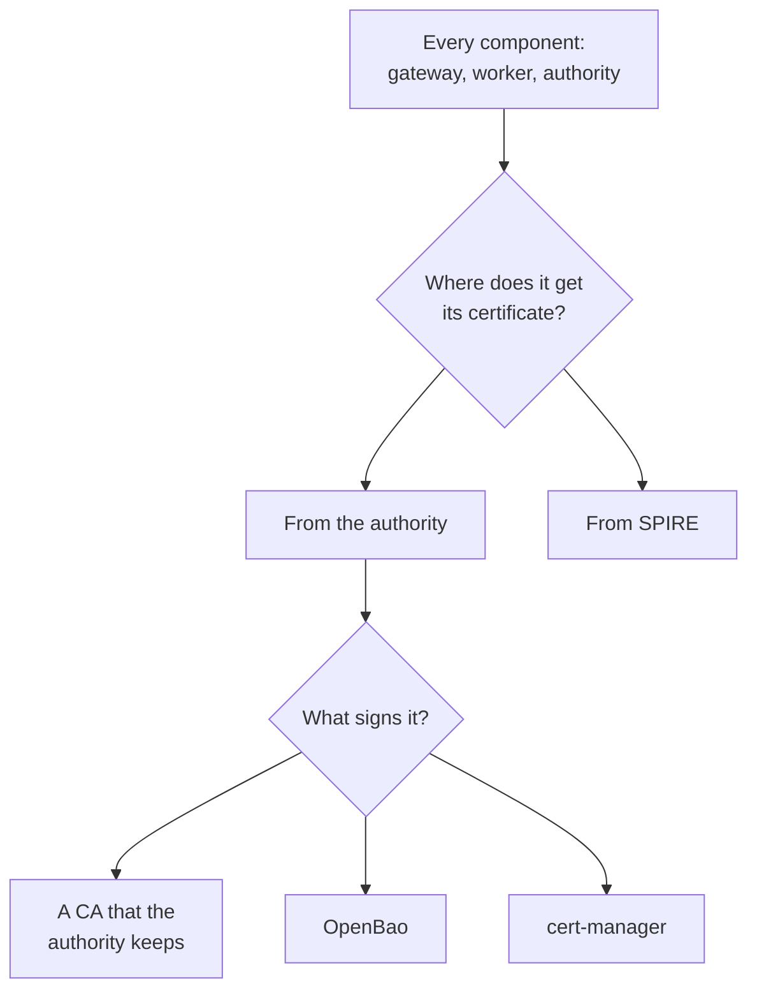
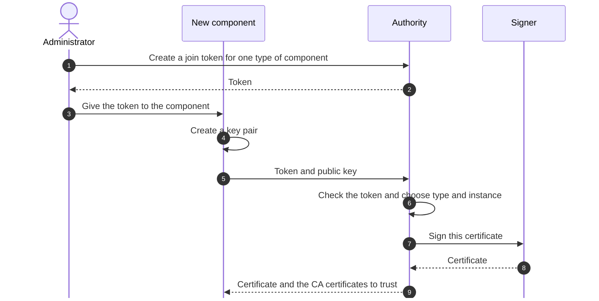
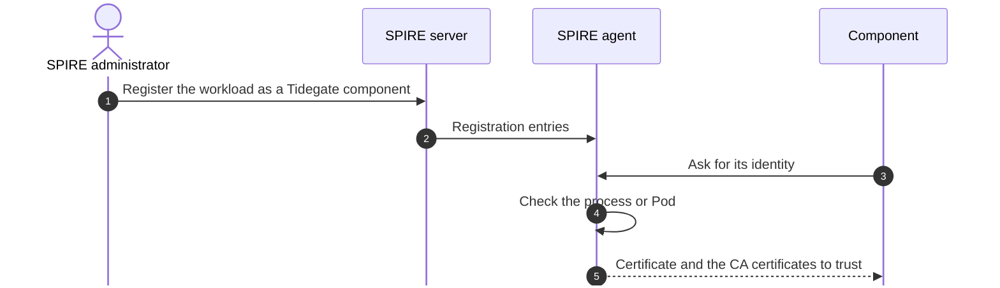

# TEP-0007: Workload identity for the internal mesh

## Summary

Tidegate's components talk to each other over mutual TLS, and each one has to prove which component it is. [TEP-0002](../0002-architecture/README.md) says so, and [TEP-0005](../0005-gateway-sessions/README.md) builds on it, but neither says where a component's certificate comes from. This TEP defines that.

A certificate carries one SPIFFE ID that names the installation and the component's type and instance. Every component checks that ID on every connection in the mesh. The operator chooses where the components get their certificates: from the authority, or from SPIRE if they already run it. When the authority hands out the certificates, the operator also chooses what signs them: a CA that the authority keeps itself, OpenBao or cert-manager. Nobody has to run a CA for Tidegate or sign a certificate by hand.

## Motivation

The authority's internal API accepts any caller today, because nothing issues the certificates it would check. TEP-0002 says that each component has "a workload identity issued by one of the authority's certificate authorities". TEP-0005 relies on that identity when it lets only a worker redeem a ticket and only the right gateway create a session. No TEP says how the CA is created, how a new gateway or worker gets its first certificate, or what the certificate contains.

The simplest answer is that every component reads its certificate from files the operator provides. The operator then has to run a CA and sign a certificate for every component by hand. Few operators will do that for one tool.

Tidegate has to work in two kinds of installation. Some operators run it in Kubernetes and already have software that issues certificates. Others run it on servers that they set up by hand, without such software.

### Goals

- Every component has an identity that names its type and instance, and every connection in the mesh checks it.
- An installation on servers that are set up by hand needs no other software for this.
- An operator who runs OpenBao, cert-manager or SPIRE can use it for the components' certificates.
- A certificate looks the same and is checked the same way, wherever it comes from.

### Non-goals

- The certificates that users see, like the authority's certificate for its external API.
- The authority's other keys. TEP-0005 keeps the key for admission tickets and the SSH CAs apart from mesh TLS.
- Which type of component may call which method. TEP-0005 and the later API TEP decide that.

## Proposal

### What a certificate says

A component's certificate carries one URI in its subject alternative names, a [SPIFFE ID](https://github.com/spiffe/spiffe/blob/main/standards/SPIFFE-ID.md). It names the installation and the component's type and instance:

```
spiffe://tidegate.example.com/ssh-worker/5d2c9b0e
```

Tidegate uses the SPIFFE format for the name. It doesn't need other SPIFFE software for that.

A peer first verifies the certificate against the CA certificates it trusts. Then it checks this ID. A component that connects to a worker checks that the certificate names the worker instance it expects. It doesn't check a host name, and a certificate needs no DNS names. TEP-0005 requires this: "A DNS name or network location alone is insufficient."

A component has one certificate. It uses it as a client and as a server, because a worker accepts connections from a gateway and opens connections to the authority.

### Where certificates come from

The operator makes two choices. The second choice only exists when the certificates come from the authority.



An installation is one of these four:

| Where certificates come from | What signs them |
|---|---|
| The authority | A CA that the authority keeps |
| The authority | OpenBao |
| The authority | cert-manager |
| SPIRE | SPIRE. Tidegate doesn't take part |

Three things are the same in all four and can't be configured: what a certificate looks like, what a peer checks on a connection, and which type of component may call which method.

### Certificates from the authority

The authority decides who gets a certificate and what it says. The signer only signs. Gateways and workers never talk to the signer.



The private key never leaves the component.

A signer must issue certificates with this installation's IDs to the authority and to nobody else. Anyone else who can get such a certificate from the same CA passes as a Tidegate component.

### Certificates from SPIRE

With SPIRE, the authority hands out nothing. Each component, the authority included, gets its certificate from the SPIRE agent on its host.



With SPIRE, more people can create a Tidegate component. Whoever may register workloads in SPIRE can create an identity that the authority accepts as a worker, and a worker receives credentials for targets. With certificates from the authority, only a Tidegate administrator can do that.

### User stories

- An operator installs the authority, a gateway and a worker on three servers by hand. They create a token for the gateway and one for the worker with the CLI, and each component fetches its certificate when it starts.
- An operator who runs OpenBao points the authority at a PKI issuer there. The CA key stays in OpenBao, and components still join with tokens.
- An operator who runs SPIRE registers the Tidegate components as workloads. No tokens exist in that installation.

### Risks and mitigations

Not written yet.

## Design details

Not written yet. The sections below name what each one has to answer.

### Joining through the authority

How a component proves once that it may join, where it sends that proof while it has no certificate, how it knows that it talks to the real authority at that moment, and what a join token is bound to.

### Certificates from SPIRE

What a SPIFFE ID must look like so that the authority accepts it as a type and an instance, how a component reaches the SPIRE agent, and how the authority learns which CA certificates to trust.

### The signer

What the authority asks of a signer, and which of the three signers exist in the first version.

### Keeping certificates valid

How long a certificate lives, how a component renews it, how a removed component stops working, and how the CA is replaced.

### The authority's own start

Where the authority's own certificate comes from, what happens on the first start, and how several authority replicas share one CA.

### What the operator does

The steps that are left for a person, in Kubernetes and on servers set up by hand.

## Security considerations

Not written yet.

## Compatibility and upgrade

Not written yet. This TEP changes one statement of TEP-0002: CA keys are only stored in Postgres when the authority keeps the CA itself. It also replaces the files from which the authority reads the certificate of its internal API today.

## Test plan

Not written yet.

## Rollout

Not written yet.

## Drawbacks

Not written yet.

## Alternatives

Not written yet. Three are known so far: certificates from files the operator provides, accepting only identities from the authority and adding SPIRE later, and putting type and instance into the certificate's common name.

## Unresolved questions

- Does this TEP cover agents, or only gateways and workers? TEP-0002 has agents join with a single-use token too.
- What protects the CA key when the authority keeps the CA? The TOTP secrets, the SSH CAs and the key for admission tickets need the same answer. That may be a TEP of its own.
- What is the installation part of the SPIFFE ID, and who sets it?
- What are the type names? TEP-0002 says web-gateway and proxy, TEP-0005 says session-gateway and SSH worker.

## Implementation history

